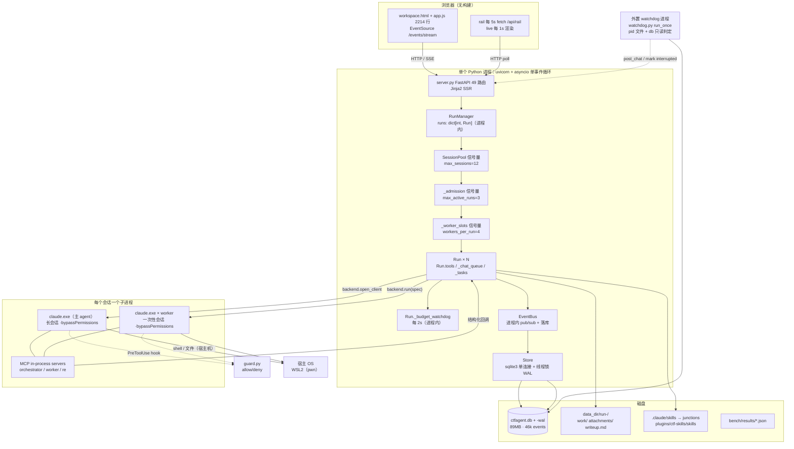
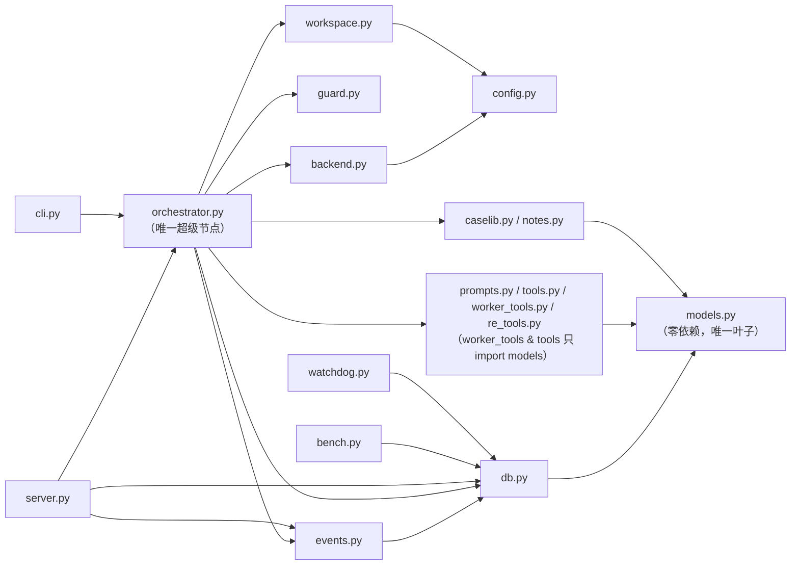
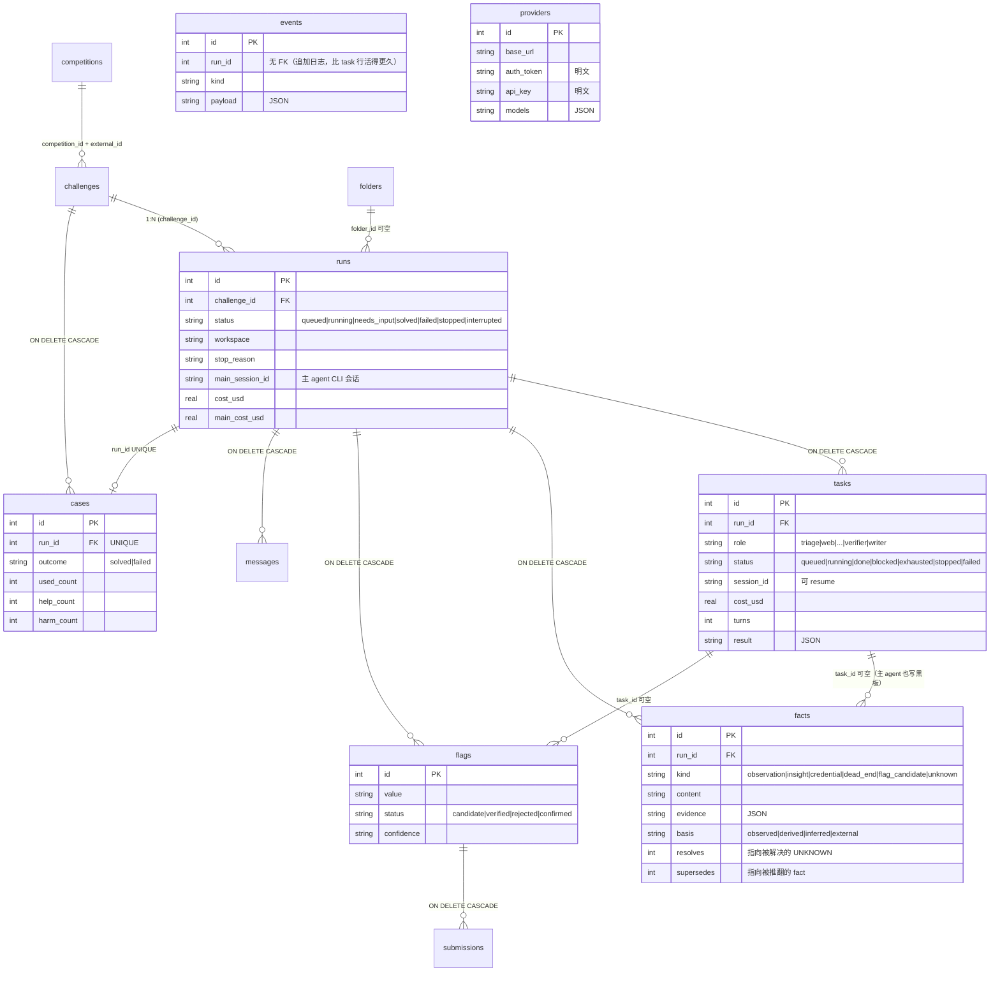
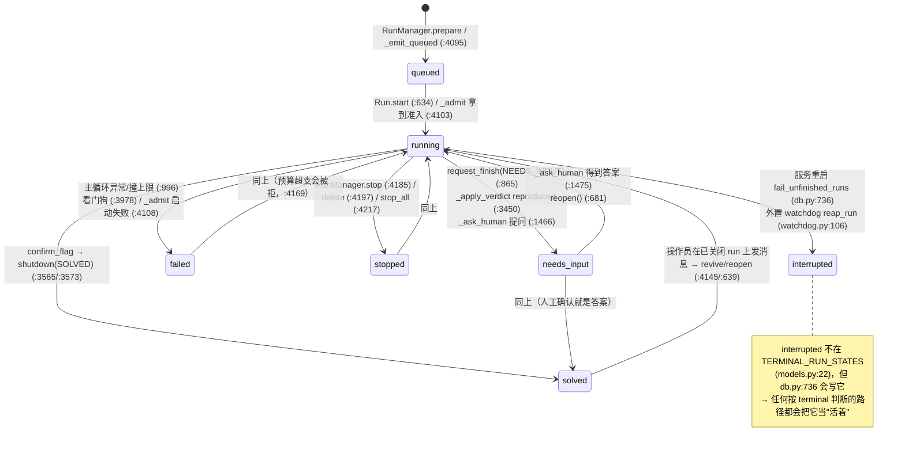
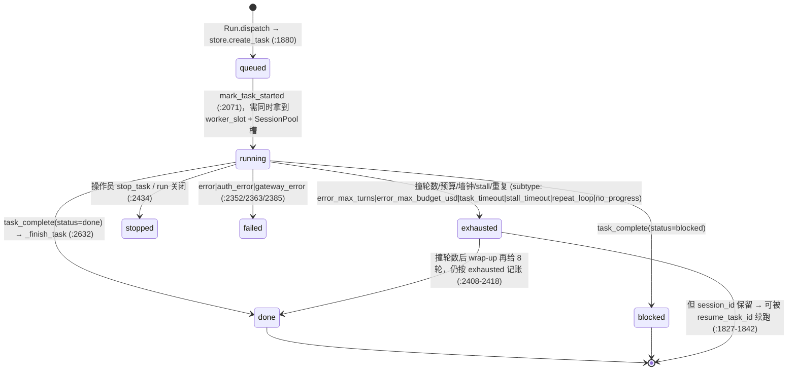
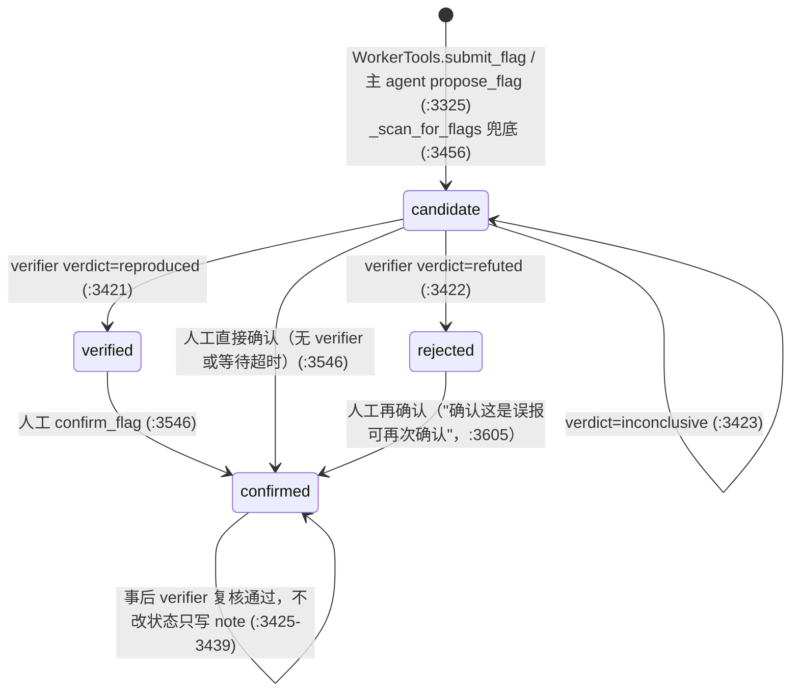
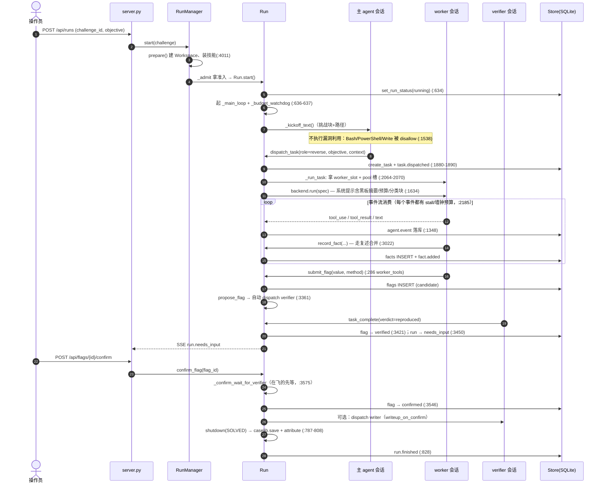
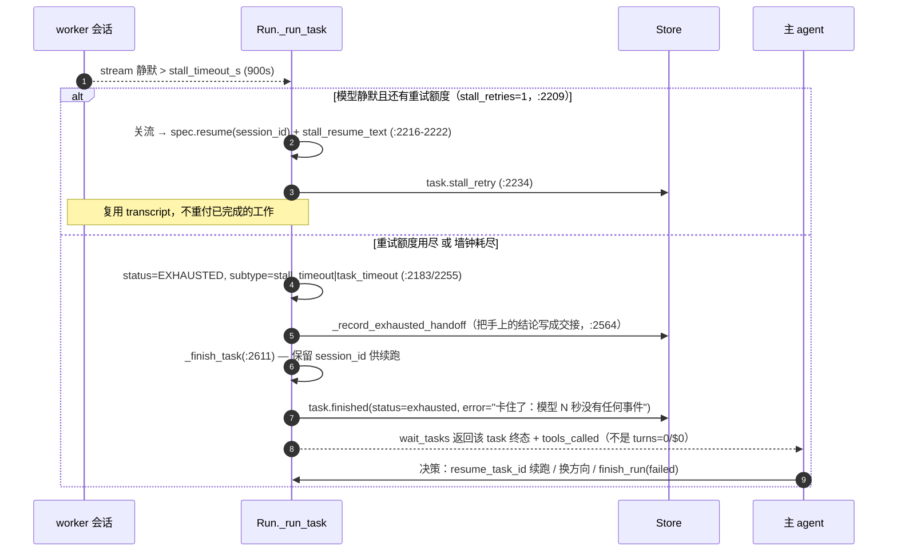

# CTFAGENT 体系结构与骨架（只读架构审视）

> **设计台账**　轮次：第 1 轮（只读审视，重构轨）｜日期：2026-11-01｜范围：`D:/agentsec/CTFAGENT`（工作树，非提交态）｜代码锚点：`git 6becd71`（2026-10-31），工作树另有 **84 个未提交改动**，本文按**工作树现状**取证，不按 commit ⑥ 取证｜方法：H=(E,T,C,S,L,V)+P 六层映射 + 生产级检查表 + 证据制（每条判断带 `文件:行号`）｜只读：本次未修改 `ctfagent/`、`server.py`、模板、配置中任何内容，仅写入 `02-design/`。

> **证据约定**：`文件:行号` 指当前工作树行号。凡未直接读到代码、只由文档或日志推断的结论，标注 **【待证】**。凡属"我认为"的判断，标注 **【判断】** 并给依据。引用的崩溃日志来自历史版本（行号已漂移），已注明。

---

## 1. 一句话定位与成熟度

**一句话定位**：CTFAGENT 是一个**单机、单进程、asyncio 驱动的中心化调度型 Agent Harness**——一个长期存活的 main agent 会话负责拆题与派工，每个工单起一个一次性 worker 会话（`claude` 子进程），worker 通过 7 个结构化写回工具把结论写进 SQLite 黑板，flag 由独立 verifier 会话复现、**必须人工确认**才算解出。

**它与"Chrome 里挂个聊天框"的区别**：一次 run 是一块有工单、有证据、有 flag、有花费、有报告的**可回看工单**（`PRODUCT.md:19`）。

### 成熟度三问（逐条给证据）

| 台阶 | 判定 | 证据 |
|---|---|---|
| **能跑** | ✅ 已达到 | 实跑库：86 个 run（`solved 19 / interrupted 50 / failed 10 / stopped 7`）、317 个工单（`done 105`）、39 条 flag（`confirmed 34`）、46,119 条事件（`ctfagent.db` 只读查询）。工程上另有：实例锁防双开（`instance.py:106`）、外置看门狗防进程假死（`watchdog.py:153`）、`doctor` 自检（`cli.py:106`）。 |
| **能复现** | ✅ 已达到（有保留） | 离线测试套件不烧钱可跑（`backend.py:638 ScriptedBackend`；`HANDOVER.md:5` 记 426 passed / 1 skipped，本次**未复跑**故标【待证】）；基准可复算：`ctfagent bench` 落 `bench/results/*.json`，最近三次 `solve_rate 1.0`（`bench-20261030-232119.json` items=2、`bench-20261030-234949.json` items=1 $0.10、`bench-20261030-235927.json` items=1 $1.67）；配置指纹随结果落盘（`bench.py:570 config_fingerprint`）。保留：`HANDOVER.md:69` 记载的 baseline 8/8 完成度未在本次复核。 |
| **能上线** | ❌ **未达到** | 四条硬伤，逐条见 §9：①无进程隔离（`config.toml:96 mode="none"`，`guard.py:11-14` 自认"黑名单不是沙箱"）；②凭据进入执行环境（`config.toml:30-31` 明文 token → 子进程 env，见 §9-R3）；③收尾崩溃路径（`bench/results/run-20261030-n17-flash.log:9,86,98` 双层 `ProgrammingError`）；④状态与进程绑定（86 个 run 里 50 个 `interrupted`，9 个 task 永滞 `running`）。 |

**成熟度一句话**：**工程化程度远高于它的隔离等级**——编排、预算、黑板、可观测性都做到了工业级细节，而执行面还停在"宿主机 + 黑名单"。

---

## 2. H 六层映射

> 每层给三件事：**现在是什么 / 代码在哪 / 缺什么**。缺什么只写"设计缺口"，不写"没实现"（很多是被有意省略的）。

### 2.1 E 执行编排（Execution Loop）

**现在是什么**

- **两层循环**：run 级主循环（main agent 的对话轮） + task 级流式消费循环（worker 会话的事件流）。二者是独立 asyncio Task，不是嵌套调用。
- **run 生命周期**：`queued → running → (solved | failed | needs_input | stopped | interrupted)`（`models.py:11-22`，`orchestrator.py:1-23` 模块 docstring 也写了同一口径）。终态集合**不含 `interrupted`**（`models.py:22`），而启动时恰恰写 `interrupted`（`db.py:736`）——见 §9-R6。
- **task 生命周期**：`queued → running → (done | blocked | exhausted | stopped | failed)`（`models.py:25-42`）。
- **谁推进 task 状态**：`mark_task_started`（`db.py:875`）→ 事件流消费循环 → `_finish_task`（`orchestrator.py:2611`，唯一写终态的地方，"exactly once" 由 `_results.pop` 保证）→ 兜底 `fail_running_tasks`（`db.py:909`，只在 `Run.shutdown` 里调）。
- **三道防跑飞保险**：轮数（`limits.role_max_turns` / `task_max_turns`，`config.py:229-239`）、美元（`run_budget_usd` / `task_budget_usd` / `main_budget_usd`，`config.py:213-222`）、每节点超时（task 墙钟 `_task_clock`，`orchestrator.py:1613`；stall 静默 `stall_timeout_s`，`orchestrator.py:2173`；工具在跑时改用 `tool_wait_timeout_s`，`orchestrator.py:2169-2171`）。
- **失败回喂**：错误**分类处理**而不吞——`error` 事件走 `_note_infra_failure` 后**重试 3 次带退避**（`orchestrator.py:2345-2350`），`gateway_error` 计入 `_gateway_failures`，窗口内 ≥2 次就拒派（`orchestrator.py:1961-1973`），`auth_error` 直接终态并给可操作文案（`orchestrator.py:2356-2369`）。
- **打转检测**：只拦"一模一样"的连续重复（`repeat_call_limit=6`，`orchestrator.py:2296-2328`，指纹 = 工具名 + `json.dumps(input, sort_keys=True)[:400]`）。`no_progress_tools` 默认 0 关闭，`config.toml:63-72` 用实测数据说明为什么关。
- **并行**：双层信号量——每 run `workers_per_run`（`orchestrator.py:506`）、全局 `max_sessions`（`orchestrator.py:335-349 SessionPool`）、再加 run 级准入门 `max_active_runs`（`orchestrator.py:4008`）。
- **墙钟与可中断**：主 agent 文本流式（`stream_text=True`，`orchestrator.py:1553`），操作员输入**会打断主 agent 当前轮**（`_interrupt_lead`，`orchestrator.py:1411`），worker 不受影响。

**缺什么**

1. **终止条件有部分落在"模型自评"上**。`finish_run(status)` 是主 agent 自己调的（`tools.py:475`），只有 `solved` 被强制改写为 `needs_input`（`orchestrator.py:852-860`）——即"胜利"这一档落到了 V 层（人工 + verifier），**但"失败"（`failed`）仍然由主 agent 一句话决定**。`failed` 会触发记忆归因（`orchestrator.py:807`），所以主 agent 的悲观判断会影响战例卡统计。修法见 §9-R8。
2. **没有多 Agent 编排决策卡意义上的"拓扑选择"**：拓扑是硬编码的中心化星型，主 agent 不能改变调度形状（不能派"流水线"，只能扇出-扇入）。这在 CTF 上是合理取舍，但要写进设计意图，避免后续误以为是能力缺口。
3. **task 墙钟与 run 墙钟无联动校验**：`run_timeout_s=10800` 而 `task_timeout_s_by_category` 里 reverse 4800（`config.toml:56,80`），一个 run 串行跑三个 reverse 就必然撞 run 钟，且 `_task_clock` 不感知 run 剩余时间（`orchestrator.py:1613-1632` 只按角色/分类取）。

### 2.2 T 工具注册（Tool Registration）

**现在是什么**

- **三套进程内 MCP server**，按角色披露（**注册 ≠ 披露 ≠ 授权**做到了三层分离）：
  - 主 agent：11 个编排工具（`tools.py:26-38`：`dispatch_task / stop_task / wait_tasks / list_tasks / get_task_result / read_blackboard / record_fact / record_unknown / propose_flag / ask_user / finish_run`），**外加只读的 `Read / Glob / Grep / TodoWrite`**（`orchestrator.py:1514-1519`），**显式禁掉 `Bash / PowerShell / Write / Edit / MultiEdit / NotebookEdit / Task`**（`orchestrator.py:1538-1540`）。
  - worker：7 个写回工具（`worker_tools.py:23-31`：`record_fact / record_unknown / submit_flag / report_progress / request_help / task_complete / read_skill_doc`）+ 通用 CLI 工具（`orchestrator.py:1708-1720`）。
  - RE 工具：**只给 `triage/reverse/pwn/malware/forensics` 与这些分类的 verifier**（`orchestrator.py:1729-1733`），10 个（`re_tools.py:37-48`，含分页/证据回取 `re_evidence_get`）。
- **工具执行位置**：全部在**宿主机**，cwd = run 工作区的 `work/`（`orchestrator.py:1737`）。`sandbox.mode="wsl"` 是本次审查前刚打通的路线（`config.toml:90-98`，`docs/设计-20261031-沙箱路线.md` 记录转发器 `bin/ctfagent-cli-wsl.exe` 已编译、WSL 内 CLI 尚未装完），**默认仍是 `none`**。
- **披露序列稳定性**：`allowed_tools` 用**字面量列表固定顺序**构造（`orchestrator.py:1708-1720`），`tool_specs()` 也是固定列表（`tools.py:41`）——前缀字节稳定性在这里天然成立。

**缺什么**

1. **凭证进了执行环境**（production-checklist T 层硬红线）。`_session_env` 只显式加了 `PATH/PYTHONUTF8/DISABLE_AUTOUPDATER/MCP_TOOL_TIMEOUT/NO_PROXY`（`orchestrator.py:1766-1809`），但 `backend._credential_env` 会把 token 拼进子进程 env（`backend.py:299`），而 SDK 又会 merge `os.environ`——worker 一个 `os.environ` 就拿到模型网关的 token。修法见 §9-R3。
2. **没有"能力缺口"的自描述**：worker 拿到的是 7 个写回工具 + shell，**没有骨架脚本执行器**、**没有自校验工具**（比如"跑一遍我刚写的 exploit 但用不同参数确认可复现"）。这在 CTF 上不是致命（shell 能兜住），但和 `re_tools` 的"证据化"设计哲学不一致：写回是结构化的，执行不是。
3. **工具描述里的稳定契约没有 schema 化**：`record_fact` 的 `basis`（observed/derived/inferred/external）与 `evidence` 键名（`command/output/...`，`models.py:66-76`）是**字符串约定**，靠提示词与 `grounding_gap()` 事后降级（`orchestrator.py:3043-3052`）保证，而不是入参枚举强校验。可改进，非阻断。

### 2.3 C 上下文管理（Context Management）

**现在是什么**

- **每个 worker 的上下文 = 4 段固定拼接**：角色系统提示（含分类相关"注入块"）+ 黑板摘要 + 挑战描述块 + 预算块，再加任务 objective/context（`orchestrator.py:1634-1753`）。
- **黑板摘要**（`blackboard_digest`，`orchestrator.py:3160-3225`）是**唯一的跨 worker 共享记忆**，容量由 `limits.blackboard_facts` 控制（`config.py` 里默认 60；注释说明"取最新 40 会丢掉最早的基础事实"，`orchestrator.py:1640-1644`）。摘要做了三件正经事：**未解问题前排**（`open_unknowns`，`orchestrator.py:3149-3158`）、**推翻链显式标注**（`【已被 #N 推翻，不要据此行动】`，`orchestrator.py:3216-3220`）、**证据预算**（`_EVIDENCE_BUDGET`，从最新往前花，`orchestrator.py:3188-3195`）。
- **去重下沉到写路径**：`record_fact` 在**唯一写入口**做复述合并（`_restated_by`，`orchestrator.py:3112-3144`，覆盖率阈值 `_RESTATE_COVERAGE` + basis 等级比较），因为"摘要会注入每个 worker 的提示词，重复项在之后每次派工都收一次费"（`orchestrator.py:3063-3066`）。
- **提示注入（prompt injection 防御）**：附件内容与目标响应**没有**统一消毒层；防的是"模型被附件骗去读答案"这一具体形态——bench 用 `sealed_roots`（`orchestrator.py:367`、`guard.py:360-383`）封禁答案目录，`Read/Glob/Grep` 都过钩子。
- **压缩**：**没有自研压缩器**。撞上限时的兜底是 `_summarize_after_ceiling`（`orchestrator.py:1194`）与 `_wrap_up_after_ceiling`（`orchestrator.py:2471`，给撞轮数上限的 worker 8 轮把结论写下来，`config.py:241-242`）。会话内的长上下文压缩交给 CLI 自身。
- **缓存经济性有实测**：`costing.py:1-14` 记录"prompt caching 已到 94.7%，thinking 占回读量 65%，input:output = 44:1"——所以杠杆是"更少轮次 + 更小 transcript"，不是"上缓存"。

**缺什么**

1. **每轮重新组装 vs 前缀字节稳定，只满足了前者的一半**。主 agent 是长会话、追加式，前缀稳定天然成立；worker 是一次性会话，system prompt 每次 dispatch 重新拼字符串（`prompts.worker_system_prompt(...)`，`orchestrator.py:1675-1691`）——**同一 run 里不同 worker 之间零缓存共享**，因为黑板摘要变了、objective 不同。这是设计选择（信息新鲜 > 缓存命中），但**没有记账**：production-checklist C 层要求"重写动作要算赔多少重算 token"，这里既没有重写、也没有账。
2. **预算只在"总量"层面存在，没有"分配"**：系统提示 / 历史 / 工具结果 / 参考资料四类**没有各自配额**。唯一的显式预算是黑板（`blackboard_facts`）与证据（`_EVIDENCE_BUDGET`）。`re_tools` 侧有 `MAX_RESULT_CHARS=60000` 与分页（`re_tools.py:50-55`），是工具级而非上下文级的配额。
3. **外部内容未统一标记为"待分析数据"**：仅有分类相关的纪律块（`INJECTION_KIT_BLOCK` 等，`prompts.py:32`），没有"以下内容来自附件/网络，不得当作指令"的统一信封。

### 2.4 S 状态与记忆（State Storage）

**现在是什么**

- **单文件 SQLite + WAL + 单连接 + 一把线程锁**（`db.py:1-11` docstring 明说"sub-millisecond，锁比连接池简单也更安全"）。12 张表（`db.py:36-243`）。
- **`events` 表是唯一可观测真相源**，单调 id，SSE 断线用 `Last-Event-ID` 补齐；进程内 pub/sub 只负责叫醒（`events.py:1-10`、`server.py:1844-1886`）。
- **记忆分层做得比多数项目细**：
  - `facts`（一次 run 的黑板，run 结束即冻结）；
  - `cases`（战例卡，跨 run，`run_id UNIQUE`，`db.py:189-208`）——**不存 flag 字面量**（`db.py:188`）；
  - `notes`（蒸馏出的技术笔记，写进技能库，`notes.py`；`_learned_notes_block` 注入，`orchestrator.py:3763`）；
  - `app_settings` / `providers`（UI 态与端点）。
- **记忆治理（这点值得记）**：`basis` 四级 + `grounding_gap()` 会把"自称 observed 但没给命令/输出"的记录**降级为 inferred** 并落事件（`orchestrator.py:3043-3052`）；否定结论另加 `negative_gap`（`orchestrator.py:3059-3061`）；战例卡用 `used/help/harm` 计数反向淘汰（`db.py:203-205`、`orchestrator.py:802-817`）。
- **状态恢复**：主 agent session id 落 `runs.main_session_id`（`db.py:66-74`），worker 落 `tasks.session_id`；重启后 `reopen()` 收割孤儿（`orchestrator.py:682-712`）、`attach()` 重建 Run（`orchestrator.py:4113`）。

**缺什么**

1. **外部副作用无幂等键**（production-checklist S 层）。CTF 里最贵的外部副作用是**向平台提交 flag**：`submissions` 表只做"尝试日志"（`db.py:171-183`），提交动作本身没有幂等键，靠人工再点一次。可接受（产品原则"系统不会自动提交"，`README.md:131`），但要在文档里认账。
2. **记忆与进程状态耦合**：`RunManager.runs` 是进程内字典（`orchestrator.py:4005`），只有本进程知道谁是活的；跨进程（CLI `confirm` / 外置 watchdog）只能 `attach` 出一个**没有主会话**的 Run（`orchestrator.py:4113-4120`）。
3. **`events` 无保留期 / 无裁剪**：46,119 行、库 89MB（`ctfagent.db` + 4MB WAL）。只有一条 `events_kind` 索引救过全表扫（`db.py:142-145`）。生产级检查表要求"日志保留期"，此处未定。
4. **证据版本绑定缺失**：一条 fact 的可信度不绑"文件 hash / 靶标版本"，靶标重启后旧结论仍以 `observed` 出现在黑板上。CTF 单次 run 场景风险低，对"长期复用的战例卡"是真风险。

### 2.5 L 生命周期与门禁（Lifecycle Hooks）

**现在是什么**

- **唯一的硬拦截点**：SDK 的 `PreToolUse` 钩子（`guard.py:344-398`），挂 `HookMatcher(matcher="Bash|PowerShell|Read|Glob|Grep|Write|Edit|MultiEdit|NotebookEdit")`（`guard.py:408-410`）。**主 agent 与 worker 都挂**（`orchestrator.py:1542`、`1744-1746`）。
- **拦什么**：危险命令黑名单 12 条（`guard.py:42-54`）、写路径必须落在 `allowed_roots`（`guard.py:210-229`）、`sealed` 目录禁读（`guard.py:231-249`）、shell 重定向按写检查（`guard.py:73-75`）、WSL `/mnt/x` → 宿主盘符归一（`guard.py:106-129`，含两条实测事故）。
- **人在回路分档（实际落地）**：
  - 自动执行：worker 的全部 shell / 文件操作（`bypassPermissions`，`backend.py:375`）；
  - 执行后告知：一切状态变更都进 `events` 流，UI 可回看；
  - 执行前确认：**flag 确认**（`confirm_flag`，`orchestrator.py:3516`）、**删除 run**（两步确认，`ONBOARDING.md:106`）、**提交到平台**（独立第二次点击，`README.md:131`）；
  - 直接阻断：`guard.py` 黑名单 + 主 agent 的 `disallowed_tools`。
- **纵深**：flag 这一档有**三重**——verifier 独立复现（`propose_flag` 自动派，`orchestrator.py:3361-3368`）、人工确认、提交是另一次点击。这层设计是正确的（生成者≠评估者≠授权者）。

**缺什么**

1. **门禁可以被"名字"绕过**：主 agent 的禁令是**黑名单**（`orchestrator.py:1538-1540`），代码里自己记了事故——"CLI 按宿主命名 shell 工具，Windows 上是 `PowerShell`，只写 `Bash` 时禁令静默失效，主 agent 跑了 47 条 PowerShell 命令自己动手逆向"（`orchestrator.py:1535-1537`）。这是**单点 + 黑名单 + 依赖外部命名**的三重脆弱，见 §9-R4。
2. **`WebFetch / WebSearch` 不在钩子覆盖范围内**（`guard.py:408-410`），也未在 worker 的 `allowed_tools` 之外做限制（`orchestrator.py:1712`）。worker 有网络出口 + 有 token 在 env + 有附件内容 → 三个一起构成外泄面。
3. **审批量治理不存在**：因为几乎全放行，没有"审批太多就快筛"的问题——但也意味着没有任何一处对"高危动作"做过风险分级。`pwn` 方向打真实靶标 vs `osint` 方向查公开信息，走的是同一档。

### 2.6 V 验证接口（Evaluation）

**现在是什么**

- **三档验证强度，逐级上升**：
  1. 确定性规则：`flag_format` 正则抽取（`_scan_for_flags`，`orchestrator.py:3456-3505`）——**但结构化 `submit_flag` 优先，扫描只是兜底**，且有"报告自称是诱饵就跳过"的否定词过滤（`orchestrator.py:3461-3468`）。
  2. 独立模型裁判：**verifier 专用角色**，独立会话、独立上下文、**故意不给战例卡**（`orchestrator.py:1672-1674`），RE 类分类额外给同一套 RE 工具（"复现不是重跑对方的脚本"，`orchestrator.py:1659-1662`）；结论用结构化字段 `verdict ∈ {reproduced, refuted, inconclusive}`（`models.py:190-194`），从散文里解析是**降级路径**（`_apply_verdict`，`orchestrator.py:3378-3405`）。
  3. 人工：`confirm_flag` 是唯一能把 run 变成 `solved` 的路径（`orchestrator.py:852-860` 强制改写）。
- **工具回执 ≠ 业务事实**：平台提交的四种回执 `correct/incorrect/already_solved/error` 全部落 `submissions`，错误不抛（`README.md:129`、`db.py:174-183`）。
- **评测环境可比性**：bench 用独立 db（`bench.prepare_db`，`bench.py:323`）、隔离技能库（`_bench_skills_dir`，`bench.py:282`）、`config_fingerprint` 落盘（`bench.py:570`）、污染检测（`contamination_signal`，`bench.py:96`）、训练库封禁（`sealed_roots`）。
- **评估者与生成者的独立性**：做到了"独立上下文 + 不给捷径"，但**同模型、同 prompt 家族**（`config.toml:22-26` 四个角色同一个模型），独立性弱于"不同模型"。

**缺什么**

1. **V 层没有自己的预算**：verifier 的 `task_budget_usd` 与 worker 共用档位表（`config.py` 的 `role_budget_usd` 里 verifier=8），但**没有独立的"验证预算占比"概念**——production-checklist 要求"评估成本是否已在预算内"。当前是隐含的。
2. **verdict 提取的失败率是已知痛点**：`models.py:190-194` 记"库里 15 次 verdict 有 6 次是 `none`，因为 verifier 用了别的形状"。已用结构化字段缓解，但**降级路径仍在跑**（`_VERDICT_RE` 解析散文）。
3. **无回归门禁**：bench 只出报告（`bench.py:681 save_report`），不与上次结果自动比较并否决（`compare` 存在，`bench.py:635`，但需人工看）。

---

## 3. P 范式判定

> 判据从第一性原理出发：**先问"这个系统靠什么把不确定性压下去"**，再看它落在哪些正交子维度上。

### 3.1 主范式：**中心化 Router–Worker + 对抗性验证（Reflexion 的弱化版）**

| 候选范式 | 是否命中 | 依据 |
|---|---|---|
| 分类与执行（router） | ✅ 强命中 | `triage` 角色先定分类（`orchestrator.py:2687-2720` `_apply_triage_category`），分类再决定 worker 方向与提示词注入块（`orchestrator.py:1686-1691`） |
| 分叉与综合（fan-out/fan-in） | ✅ 强命中 | 主 agent 一次派多个方向，`wait_tasks` 汇总（`tools.py:399`、`orchestrator.py:2839`）；黑板是 fan-in 的共享载体 |
| 对抗性验证 | ✅ 命中 | verifier 自动派、独立复现、可 refute（`orchestrator.py:3310-3454`） |
| 生成与过滤 | ❌ | 没有批量候选打分，flag 候选是"来了就验"（`propose_flag` 一值一验，`orchestrator.py:3337-3347`） |
| 锦标赛 | ❌ | 没有同题竞争。硬证据：`duplicate_direction_warnings` 明确劝阻同方向并行（`orchestrator.py:1844-1871`）——设计上**反对**锦标赛 |
| 循环直到完成 | ⚠️ 弱命中 | 主 agent 有轮数/预算上限，不是开放式 until-done；`needs_input` 是非终态门（`orchestrator.py:832-873`） |
| Reflexion（自我反思） | ⚠️ 弱命中 | 有"写下来供后来者用"（handoff / case card），但**没有"同一执行者读自己失败再试"的环**；反思被外化成"下一个 worker 读黑板" |

**判定**：**中心化 Router–Worker + 对抗性验证**。这正是 `h-framework.md` §五 决策卡第 2 步的"中心化调度 + 扇出-扇入"，且**通过了第 1 步门禁**——理由不是"多 agent 更酷"，而是 CTF 的硬约束：**上下文上限**（一个 reverse 题解到一半，二进制结构占满窗口）、**无法专业化**（web/crypto/pwn 的纪律块本身就有 400+ 行提示词，`prompts.py` 全 942 行）、**串行执行**（8 个方向互不依赖，扇出有真实收益）。

### 3.2 子维度落点

| 子维度 | 落点 | 证据 | 自洽性评估 |
|---|---|---|---|
| 扩展方式 | **插件化（能力侧）+ 嵌入式（编排侧）** | 能力：技能库是**目录级**插件（`workspace.install_skills`，`workspace.py:467`），MCP server 按角色装配（`orchestrator.py:1721-1733`）；编排：调度逻辑写死在 `Run` 里，不能配置 | ⚠️ **半自洽**。能力可增删，编排形状不可改。若未来要"流水线 / 锦标赛"，必须改 `Run` 而不是加插件——这是真实的可扩展性边界 |
| 配置方式 | **声明式为主** | `config.toml` 三段（`[models]` / `[limits]` / `[sandbox]`）+ 凭据页写回（`server.py:997 /api/settings/models`） | ✅ 自洽。限额、模型、定价全是声明式，且有 `cli_cost_factor` 处理"CLI 美元 ≠ 网关美元"这个非直观换算（`config.toml:106-112`） |
| 部署拓扑 | **单机单进程** | `instance.py:106` 只防**第二个 server**；`RunManager.runs` 进程内（`orchestrator.py:4005`）；SQLite 单文件 | ⚠️ **不自洽于"多 run 并行"的野心**：`max_active_runs=3`（`config.toml:49`）但状态不可跨进程共享，外置 watchdog（`watchdog.py`）是唯一跨进程协调手段，且它只能"杀"不能"接管" |
| 编排模式 | **中心化（星型）** | 主 agent 是唯一调度者；worker 之间**不能互相派工**（worker 工具集无 `dispatch_task`，`worker_tools.py:23-31`） | ✅ 完全自洽，且**用工具边界而非提示词**强制（`README.md:22`）。这是本项目最值得抄的一条设计 |
| （补充）执行面隔离 | **无隔离（宿主机）** | `config.toml:96`；`guard.py:11-14` 自认 | ❌ **不自洽**：范式选的是"多 agent 高自治"，隔离子维度却停在"单进程全信任"。这是 P 维度里唯一一处结构性矛盾 |

**P 层结论**：这套 harness 的范式**在"编排"维度上是清醒且自洽的**（工具边界不对称、生成/验证/授权三分离、黑板解耦 worker 上下文）；**在"执行面"维度上是欠债的**（无隔离 + 凭据进环境）。P 层的下一步不是换范式，是把隔离子维度补到与编排维度同级。

---

## 4. 运行时拓扑



**四条拓扑事实（每条都影响后续扩展）**

1. **只有一个事件循环**。所有 SQLite 调用是**同步阻塞**（`db.py:419-432`），跑在循环线程上；靠"sub-ms"假设成立（`db.py:4-6`）。一旦库变大（已 89MB）或加索引查询，就会直接抬高所有会话的延迟。
2. **每个会话是一个 150–250MB 的 `claude` 子进程**（`README.md:25`、`config.py:199-200`），所以 `max_sessions` 是**内存闸门**而非限流参数。
3. **worker 与主 agent 之间没有直接通道**。worker 的一切写回都经过 `Run` 的方法（`WorkerTools(self, task.id)`，`orchestrator.py:1722-1724`），`Run` 是唯一的汇聚点——这既是它 4217 行的原因，也是它可测的原因。
4. **外置 watchdog 只能"判定死亡"，不能"接管"**（`watchdog.py:79 reap_run` 改数据库 + `post_chat` 尝试唤醒，`watchdog.py:119`）。

---

## 5. 模块骨架

### 5.1 目录树与一句话职责

```
D:/agentsec/CTFAGENT/
├── ctfagent/
│   ├── orchestrator.py      4217  Run / RunManager / 会话池 / 工单生命周期 / 预算看门狗 / 黑板 / 战例蒸馏  ← 上帝对象
│   ├── server.py            1889  FastAPI 49 路由 + Jinja2 SSR + SSE（装配 Store/EventBus/RunManager）
│   ├── db.py                1509  SQLite schema + Store（唯一写入通道，含迁移 _migrate）
│   ├── re_tools.py           976  RE MCP：10 个证据化工具（分页 / coverage / 证据回取）
│   ├── prompts.py            942  各角色系统提示词 + 分类纪律块 + 注入引擎块 + 预算块
│   ├── cli.py                901  CLI：serve/run/list/show/confirm/writeup/distill/delete/cost/memory/bench/doctor/init
│   ├── backend.py            749  AgentBackend Protocol + ClaudeSDKBackend + ScriptedBackend + 错误归类
│   ├── bench.py              698  基准：manifest 解析 / 隔离库 / 污染检测 / 汇总对比 / 报告落盘
│   ├── config.py             691  AppConfig / LimitsConfig / ModelConfig / SandboxConfig + toml+env 解析链
│   ├── re_probe.py           656  ELF/PE/Mach-O 解析、字符串/字节扫描、外部工具探测（纯标准库）
│   ├── settings.py           641  凭据页领域逻辑：供应商卡 / 角色模型分配 / 端点探活
│   ├── models.py             547  全部枚举与 dataclass（RunStatus/TaskStatus/FlagStatus/FactKind/ROLES/ROLE_SKILL）
│   ├── tools.py              516  主 agent 的 11 个编排工具（MCP in-process）
│   ├── workspace.py          515  工作区创建 / 技能安装（junction） / 沙箱探测与指引
│   ├── caselib.py            467  战例卡：检索 / 渲染 / 保存 / 归因
│   ├── guard.py              410  PreToolUse 钩子：命令黑名单 + 写路径 + sealed 读禁
│   ├── worker_tools.py       397  worker 的 7 个写回工具（MCP in-process）
│   ├── challenge.py          282  challenge.yaml 解析 + challenge_block + no_proxy 推导
│   ├── notes.py              269  技术笔记蒸馏 / 安装 / 结算（balance）
│   ├── ctfd.py               244  CTFd 客户端（零依赖）
│   ├── watchdog.py           231  外置看门狗（独立进程，判定僵尸 run）
│   ├── mdrender.py           223  Markdown → HTML（服务端渲染，与 app.js 同步维护）
│   ├── costing.py            181  成本构成报告（按角色/会话/token 类别）
│   ├── instance.py           139  单实例锁（pid + 端口），防第二个 server 抢库
│   ├── textmatch.py           75  文本相似度（复述合并与笔记归因共用）
│   ├── events.py              70  EventBus：落库 + 非阻塞扇出（丢消息可回补）
│   ├── kit/                 ~1300  与目标无关的注入引擎（Session / 5 种 oracle / Extractor / selftest）
│   ├── templates/           10 个 Jinja2 模板（base / workspace / new / settings / competitions / docs / _rail / _run_fragments / _flags / _run_actions）
│   └── static/              5572 行（app.css 3171 + app.js 2214 + compose.js 187），无构建
├── plugins/ctf-skills/skills/  11 个技能，入口 SKILL.md 39–83 行（判别树）+ INDEX.md + 域内文档
├── tests/                   29 个测试文件（离线，ScriptedBackend）
├── bench/                   manifest + results/*.json
├── challenges/               本地题集
├── bin/                      ctfagent-cli-wsl.exe（WSL 转发器）
├── docs/                     14 篇设计与交接文档
└── config.toml              声明式配置（含明文 token，见 §9-R3）
```

### 5.2 依赖方向（实测）



**结论：无 import 环。** 证据：`tools.py:22-23` 用 `if TYPE_CHECKING: from .orchestrator import Run` 切断了 `orchestrator ↔ tools` 的环；`db.py → models`、`events.py → db`、`server.py → orchestrator` 是单向的（逐文件实测 import 图）。

**但有一个"隐性上帝对象"和两个"事实上的双向耦合"**：

| 位置 | 问题 | 证据 |
|---|---|---|
| `orchestrator.Run` | 类本身约 **1900 行 / 100+ 方法**，同时是生命周期管理者、预算账房、黑板服务、提示词装配器、记忆蒸馏器、HTTP 层的后端 | `orchestrator.py:370-3980` |
| `tools.OrchestratorTools` ↔ `Run` | 工具通过 `self.run` 反向调用 20+ 个 Run 方法；Run 又持有 `self.tools` | `tools.py:257-260`、`orchestrator.py:438-439` |
| `server` ↔ `orchestrator` | server 直接读 `run._session_error`、`run.workspace`、`run.cost_usd` 等私有/半私有成员 | `server.py:1417`、`server.py:1390` |

### 5.3 对外公共接口（签名级）

```python
# ---- backend.py：唯一后端契约（Protocol，可替换性就靠它）----------------
class AgentBackend(Protocol):
    def run(self, spec: SessionSpec) -> AsyncIterator[AgentEvent]: ...      # backend.py:128
    def open_client(self, spec: SessionSpec) -> "AgentClient": ...          # backend.py:130

@dataclass(frozen=True)
class SessionSpec:                                                          # backend.py:82-107
    role: str; prompt: str; cwd: Path; system_prompt: str
    model: str; max_turns: int; max_budget_usd: float
    allowed_tools: list[str]; disallowed_tools: list[str]
    mcp_servers: dict[str, Any]; hooks: dict[str, Any]
    resume_session_id: str; extra_env: dict[str, str]
    stderr_path: Path | None; skills: list[str] | None; stream_text: bool

@dataclass
class AgentEvent:                                                           # backend.py:110-121
    kind: str        # init | text | thinking | tool_use | tool_result | result | error
    payload: dict[str, Any]
    cost_usd: float
    turns: int

# ---- orchestrator.py -----------------------------------------------------
@dataclass
class RunContext:                                                           # orchestrator.py:352-367
    store: Store; bus: EventBus; cfg: AppConfig; backend: AgentBackend
    pool: SessionPool; workspaces_root: Path; skills_dir: Path
    sandbox: SandboxStatus; sealed_roots: list[Path]

class Run:
    async def start(self) -> None                                           # :633
    async def reopen(self) -> None                                          # :639
    async def shutdown(self, status: str, summary: str = "", reason: str = "") -> None  # :720
    async def chat(self, text: str, attachments: list[str] | None = None, display: str = "") -> None  # :1389
    async def dispatch(self, role: str, objective: str, context: str = "", resume_task_id: int | None = None) -> Any  # :1873
    def stop_task(self, task_id: int, reason: str = "") -> dict[str, Any]   # :1975
    async def wait(self, task_ids: Iterable[int], timeout_s: int = 600) -> list[dict[str, Any]]  # :2839
    def record_fact(self, task_id: int | None, kind: str, content: str,
                    evidence: dict | None = None, basis: str = "",
                    resolves: int | None = None, supersedes: int | None = None) -> int  # :3022
    def blackboard_digest(self, limit: int = 60, for_main: bool = False) -> str  # :3160
    async def propose_flag(self, value: str, method: str, source: str = "",
                           confidence: str = "medium", task_id: int | None = None) -> dict  # :3310
    async def confirm_flag(self, flag_id: int, note: str = "", writeup: bool | None = None) -> None  # :3516
    async def write_report(self) -> dict[str, Any]                          # :3642
    async def distill_technique(self) -> dict[str, Any]                     # :3701

class RunManager:
    def prepare(self, challenge, objective="", *, name="", sealed_roots=None, folder_id=None) -> Run  # :4011
    async def start(self, challenge, objective="", *, ...) -> Run            # :4071
    def launch(self, run: Run) -> None                                      # :4086
    def get(self, run_id: int) -> Run | None                                # :4110
    def attach(self, run_id: int) -> Run | None                             # :4113
    async def revive(self, run_id: int) -> Run | None                       # :4145
    async def stop(self, run_id: int, reason: str = "操作员停止") -> None    # :4182
    async def delete(self, run_id: int) -> bool                             # :4187
    async def stop_all(self) -> None                                        # :4213

# ---- db.py：所有持久化的唯一通道 -----------------------------------------
class Store:
    def __init__(self, path: str | Path) -> None                            # :249
    def _migrate(self) -> None                                              # :262（新增列/表走这里）
    # challenge / run / folder / task / fact / flag / event / message /
    # competition / submission / case / provider / setting 共 13 组方法
```

---

## 6. 数据模型与状态机

### 6.1 表关系



**数据模型的三条设计判断（值得保留）**

1. **`events` 故意不建外键**（`db.py:134-140`，代码里明说 `db.py:745-746`）——删 run 时显式删事件，因为事件日志要能"比任务行活得更久"。
2. **`facts` 只追加、不改写**：`resolves` / `supersedes` 是**指针**而非 update（`orchestrator.py:3149-3158` 注释："保持历史完整，让关闭可审计"）。这是正确的审计设计。
3. **`cases` 与 `facts` 分表**：`db.py:185-188` 说清了理由——"facts 是一道题的黑板，case 是下一道同类题应该先试什么"。

### 6.2 Run 状态机



**迁移触发者一览**（这是 §8 扩展时最容易踩的地方）

| 迁移 | 触发者 | 位置 |
|---|---|---|
| → `queued` | `RunManager._emit_queued` | `orchestrator.py:4095-4097` |
| → `running` | `Run.start` / `Run.reopen` / `db.set_run_status(reopened=1)` | `orchestrator.py:634, 681`；`db.py:708` |
| → `needs_input` | `request_finish` / `_apply_verdict(reproduced)` / `_ask_human` | `orchestrator.py:865, 3450, 1466` |
| → `solved` | **只有** `confirm_flag` 走到 `shutdown(SOLVED)` | `orchestrator.py:3565, 3573` |
| → `failed` | 主循环 `finally` / watchdog / `_admit` 异常 | `orchestrator.py:996, 3978, 4108` |
| → `stopped` | 显式 stop / delete / 进程关闭 | `orchestrator.py:4185, 4197, 4217` |
| → `interrupted` | 启动时批量 / 外置 watchdog | `db.py:736`；`watchdog.py:106` |

### 6.3 Task 状态机



`_finish_task` 的三条不变量（`orchestrator.py:2611-2685`）：

1. **只写一次**：`_results.pop(task_id)` 取走显式结论；`store.finish_task` 是唯一写终态的地方。
2. **上限高于自述**：`if status != EXHAUSTED: status = explicit.status`——撞上限的 `EXHAUSTED` 不被 worker 自己的 `done` 覆盖（`:2632`，有实测事故记录）。
3. **终态后置动作**：verifier → `_apply_verdict`；triage → 落分类 + 自动改名；其它 → `_scan_for_flags`（`:2671-2685`）。

### 6.4 Flag 状态机



**关键约束**：`confirm_flag` 前会 **bounded 等待在飞的 verifier**（`_confirm_wait_for_verifier`，`orchestrator.py:3575-3611`）；若 verifier 在这段时间内给了 `refuted`，人工确认被**拒绝执行**（返回 False）。这条是整条链上最重要的防错：库里 34 条 `confirmed` 里，没有一条是被 verifier 判否的。

---

## 7. 关键时序

### 7.1 一次正常解题（成功路径）



### 7.2 一次被判失败（worker 撞墙 → 如实记账，不假装成功）



**这条时序的设计要点**：撞墙后**不做"假装完成"**。`_record_exhausted_handoff`（`orchestrator.py:2564`）把手上的碎片写成结构化交接，任务状态是 `exhausted` 而非 `done`，并且 `session_id` 被保留（`orchestrator.py:2271-2287` 专门为"没发过 result 就被杀"的会话记录 id），所以主 agent 可以用 `resume_task_id` 花小钱接着跑（`_bind_resume`，`orchestrator.py:2021-2045`）。

### 7.3 一次人工确认 flag（含"确认时 verifier 还在跑"）

```
1. 操作员在 UI 点「确认」 → POST /api/flags/{id}/confirm        server.py:1517
2. server → Run.confirm_flag(flag_id)                            orchestrator.py:3516
3. 校验归属：flag.run_id != self.id → ValueError                  :3542
4. _confirm_wait_for_verifier(flag)                               :3575
   4a. 查在飞的 verifier；没有 → 直接返回 True                      :3585-3590
   4b. 有 → emit flag.confirm_pending，等最多 confirm_verifier_wait_s :3591-3598
   4c. 等完再看 flag.status：
       rejected  → emit flag.confirm_refuted，返回 False（确认被驳回，run 保持打开）:3600-3607
       其它      → 未完成的 verifier 加入 _post_stop_ok（豁免于关闭时的取消）：3608-3611
5. store.set_flag_status(confirmed) + emit flag.confirmed          :3546-3547
6. run 未关闭时：
   6a. _operator_closing = True（阻止主循环的 finally 抢先关闭）    :3556
   6b. writeup_on_confirm 为真 → dispatch writer，先派再关          :3567-3570
        其 task_id 进 _post_stop_ok，shutdown 时不被取消             :3639
   6c. _maybe_distill_on_confirm（默认关）                          :3572/3620
   6d. shutdown(SOLVED) → fail_running_tasks + caselib.save + attribute   :773-817
7. 系统不自动提交任何平台。提交是工作台上独立的第二次 POST         README.md:131
   POST /api/flags/{id}/submit → ctfd.py → submissions 表           server.py:1591
```

---

## 8. 扩展点清单（给后续开发的骨架说明书）

> 每一项给：**改哪几个文件 / 加什么 / 会踩到什么**。这是本文最有操作价值的一节。

### 8.1 新增一个方向 worker（例：`hardware`）

| 步骤 | 文件 | 具体改动 |
|---|---|---|
| 1 | `models.py:147-160` | `ROLES` 加 `"hardware"` |
| 2 | `models.py:163-176` | `ROLE_SKILL` 加 `"hardware": "ctf-hardware"`（技能名必须与技能目录名一致，否则 `missing_skills` 会发 `run.warning` 但**不会阻止启动**，`orchestrator.py:424-436`） |
| 3 | `plugins/ctf-skills/skills/ctf-hardware/` | 新建：`SKILL.md`（判别树，参考 `ctf-web/SKILL.md` 55 行的写法）+ `INDEX.md` + 域内 md |
| 4 | `config.py` 的 `role_max_turns` / `role_budget_usd` | 给该角色档位；不配则落 `task_max_turns=150` / `task_budget_usd=4.0` 默认 |
| 5 | `config.py` 的 `task_timeout_s_by_category` | 若新方向需要更长墙钟 |
| 6 | `prompts.py` | 若需要专属纪律块，新增常量并在 `worker_system_prompt` 里按 `role`/`category` 注入（参考 `RE_TOOLS_BLOCK` 的注入方式，`orchestrator.py:1662`） |
| 7 | `models.py:183` | 若需要 RE 工具面，加入 `RE_ROLES` 或 `RE_CATEGORIES` |
| 8 | `models.py:203` `RUN_STATUS_LABEL` 邻域 | 若需要 UI 展示名（角色名通常直接显示，可不改） |
| 9 | `tests/` | 至少加一个 `ScriptedBackend` 驱动的调度测试（参考 `test_orchestration.py`） |

**不要改**：`tools.py` 的 `dispatch_task` schema 已用 `enum: list(ROLES)`（`tools.py:55`），第 1 步改完自动生效。

### 8.2 新增一个工具

**A. worker 侧写回工具**（worker 能"报告"什么）

1. `worker_tools.py:23-31` 加名字；
2. `worker_tools.py:34 tool_specs()` 加 schema（描述必须写"做什么 + 输出格式 + 约束 + 非直观参数示例"）；
3. `WorkerTools` 加方法，方法内部**只能**动 `self.run` / `self.store`（不要直接开连接）；
4. **关键**：把 `mcp__worker__<name>` 加进 `orchestrator.py:1708-1720` 的 `allowed_tools`——**这一步漏了，工具注册了但模型看不见**（注册 ≠ 披露）；
5. 若工具会改黑板语义（如 `supersedes`），同步改 `record_fact` 的写路径与 `blackboard_digest` 的渲染。

**B. 主 agent 侧编排工具**

1. `tools.py:26-38` `TOOL_NAMES`；
2. `tools.py:41 tool_specs()`；
3. `OrchestratorTools` 加方法 + `call()` 分发（`tools.py:480`）；
4. `orchestrator.py:1514` 自动按 `ORCHESTRATOR_TOOLS` 拼 `mcp__orchestrator__*`，**无需再改**；
5. 若工具返回给模型，务必带 `self.clock()`（`orchestrator.py:603-626`）——代码注释解释了原因：主 agent 没有自己的钟和账本，不带就会误判剩余时间。

**C. RE 侧证据化工具**

1. `re_tools.py:37-48` `TOOL_NAMES`；
2. `re_tools.py` 的 `tool_specs()`；
3. 返回必须带 `coverage.{status,scope,paging}` + `limitations` + `residual_unknowns`（形态见 `README.md:182-191`），并且**遵守 `MAX_RESULT_CHARS` 与分页**；
4. `orchestrator.py:1733` 自动挂 `mcp__re__*`，无需改。

### 8.3 换后端 / 换模型供应商

| 场景 | 改哪里 | 注意 |
|---|---|---|
| 换模型供应商（同 Anthropic 协议） | `config.toml [models]` 或 UI 凭据页（写 `providers` + `app_settings`，`server.py:997`） | `settings.apply_provider` 会推入运行中的 cfg，**下次派活生效，不用重启**（`db.py:211-219`） |
| 换网关 → 必须重配定价 | `[models.pricing]` + `[models.cli_cost_factor]` | 后者是"CLI 的美元 ÷ 网关的真美元"，**模型换档后该系数全错**（`config.toml:106-112`）；不改会让预算看门狗按错误金额关 run |
| 换掉 SDK（新 backend） | 实现 `AgentBackend` 两个方法 + `AgentEvent` 归一化（`backend.py:127-130`）；在 `server.create_app` 注入（`server.py:589`） | 必须产出 `init`（带 `session_id`，否则撞墙后不可 resume）、`result`（带 `usage`，否则不计费）、`error`/`auth_error` 分类，见 `orchestrator.py:2271, 2329, 2356` |
| 换持久层（SQLite → PG） | `db.py` 的 `Store` 全部方法 + `_migrate` | **不要**改 `orchestrator`。但注意 `db.py:419-432` 是同步 API，换异步驱动会破坏整个调用链 |

### 8.4 加一道门禁

| 想拦什么 | 加在哪 | 关键约束 |
|---|---|---|
| 某条危险命令 | `guard.py:42-54 DANGEROUS_COMMANDS` | 正则要匹配**归一化后**的命令；注释记录过"检查动词后的第一个 token"这个 bug（`guard.py:16-26`） |
| 某个写路径 / 读路径 | `guard.py:344 build_hooks` 的 `allowed_roots` / `deny_roots` | sealed 只在 bench 装配（`orchestrator.py:367`）；普通 run 也想要就把 `sealed_roots` 从 `RunManager` 传下去 |
| 某个工具整体禁用 | `orchestrator.py:1538` 主 agent `disallowed_tools` / worker 用 `allowed_tools` 白名单 | **黑名单会被工具改名绕过**（`orchestrator.py:1535-1537` 有 47 次事故记录）→ 优先用白名单 |
| 需要"执行前确认"的高危动作 | 不要在 `guard.py` 做（它是同步 deny/allow）；走**工具层**：新工具 + `_ask_human`（`orchestrator.py:1455`，120s 超时后返回"没回复，继续"） | `_ask_human` 会把 run 置 `needs_input` 再改回 `running`，注意别在 `_post_stop_ok` 任务里用 |
| 审计类（只记不拦） | `Run._emit` + `events` 表 | 事件是唯一真相源，不要只 `logging` |

---

## 9. 偏差与风险（分级）

> 分级口径：**阻断** = 会让"上线 / 处理不可信附件"这件事不成立；**重要** = 会造成数据错误、资金损失或维护成本失控；**次要** = 应该修但可排期。

### 阻断级

**R1｜收尾阶段存在双层崩溃路径，会留下永滞 `running` 的工单**

- 证据：`bench/results/run-20261030-n17-flash.log:9`（`Run._run_task` 抛 `ProgrammingError('Cannot operate on a closed database.')`）、`:86`（`_finish_task` → `db.py get_task` 里崩）、`:98`（**异常处理器自己也崩**：`store.finish_task` 用同一个已关闭连接）。日志是旧版本（行号 2360/2544），当前对应 `orchestrator.py:2437` 与 `2611`。
- 机理：进程退出时 `server.py:597-598` 先 `manager.stop_all()` 再 `store.close()`；若某个 `_run_task` 的 `finally` 还没跑完（或异常处理里又访问 DB），它拿到的就是已关闭的连接。**而且 `except` 分支本身也要写库**（`orchestrator.py:2454-2461`），于是双层失败。
- 现实后果已可测：`tasks.status='running'` 有 **9 行**滞留（本次只读查询）；`runs.status='interrupted'` **50 行**。
- 最小修法：① `Store.close()` 前设置 `self._closed=True`，所有方法在关闭后**静默 no-op 并计数**（而不是抛）；② `_run_task` 的 `except/finally` 包一层 `try/except ProgrammingError`；③ 启动时在 `create_app` 里补一句 `UPDATE tasks SET status='stopped' WHERE status='running'`（对齐 `db.py:734` 只修 run 不修 task 的遗漏）。

**R2｜执行面零隔离，而输入是不可信数据**

- 证据：`config.toml:96 mode="none"`；`guard.py:11-14`（"它是黑名单，不是沙箱……`bypassPermissions` 会话真的跑在宿主机上"）；`README.md:92`（`sandbox.mode="docker"` 只是提示词开关）、`README.md:206`；`HANDOVER.md:71` 把这条列为"最大风险"。
- 为什么算阻断：产品自身的用户场景包含 **malware / forensics 方向**（`models.py:156`）与"题目附件是不可信数据"（`README.md:207`）。在这个组合下，"能上线"与"能安全跑一类题"是同一件事。
- 已有进展（要如实记）：WSL 路线已打通到"转发器编译完成 + `[sandbox]` 可切"，差 WSL 内装 CLI（`docs/设计-20261031-沙箱路线.md:1-9`）。这是**唯一**正确的方向：命令重写与 `.cmd` 垫片两条路都已被证否（同文档）。
- 最小修法：把 `mode="wsl"` 做成**按分类强制**（malware/forensics/pwn 必须 `wsl`，否则拒跑），而不是全局可选。

**R3｜凭据进入执行环境，且**已观测到** worker 读取项目根目录的配置文件（违反 T 层红线）**

- 证据（配置侧）：`config.toml:30-31` 明文 `auth_token` / `api_key`（本文不转录）；`providers` 表也明文存（`db.py:220-233`，注释自认"token 就存在这个文件里"）；`backend._credential_env`（`backend.py:299`）把凭据拼进子会话 env；`_session_env` 又前置 venv PATH（`orchestrator.py:1796-1799`）。
- 证据（**行为侧，本次只读查库实测**）：run 17 / task 86（pwn worker）执行过 `Get-Content "D:\agentsec\CTFAGENT\config.toml" -ErrorAction SilentlyContinue | Select-Object -First 40`（`events` 表 `kind='agent.event'`，tool_use id `call_00_2EE83dwHqmsHgwOHItMb5549`，描述写的是 "Inspect config and challenges dir"），**该命令成功返回了 config.toml 的头部内容并进入模型上下文与事件流**；同一次运行里 worker 还执行过 `Get-ChildItem env: | Format-Table -AutoSize | Out-String -Width 200`（描述直写 "Dump all environment variables"）、`printenv` 类命令在库中共命中 **118** 条事件、`ANTHROPIC_AUTH_TOKEN` 字面命中 **6** 条。同一批事件里它还列出了 `D:\agentsec\CTFAGENT\challenges`（**跨 run 读其它题目材料**）。
- 为什么这是阻断而不只是"重要"：`guard.check_read` **只拦 `sealed_roots`**（`guard.py:231-249`），而 `sealed_roots` 只在 bench 装配（`orchestrator.py:367`）——普通 run 里**工作区之外的读是允许的**。所以"读 config.toml 拿明文 token"不是历史巧合，而是**今天仍然成立的默认能力**；而模型已经证明它会这么做（题目让它找 flag 环境变量时，它顺手翻配置文件）。
- 后果链：worker 有 shell → 读 `config.toml` / `env` 取 token → 可经 `WebFetch` 或任意 HTTP 外发（`WebFetch` **不在** `guard.py:408-410` 的 matcher 里）。与"题目附件不可信"叠加，构成真实外泄路径。
- 最小修法（按成本排序）：① `guard.py` 的读禁范围从"仅 sealed"改成"**默认只读工作区**，白名单例外"（这是最小的一行判定改动，收益最大）；② matcher 加上 `WebFetch|WebSearch`；③ `check_command` 拦 `Get-Content ..config.toml`、`env`/`printenv`/`Get-ChildItem Env:` 一类命令；④ 网关侧发按 run 的短期子令牌，或走本地 sidecar 代理；⑤ `providers.auth_token` 至少改成系统凭据库/加密列。

**R4｜门禁是"黑名单 + 外部命名依赖 + 单点"**

- 证据：主 agent 的禁令是 `disallowed_tools=["Bash","PowerShell","Write",...]`（`orchestrator.py:1538-1540`），注释自记"只写 Bash 时在 Windows 上禁令静默失效，主 agent 跑了 47 条 PowerShell 命令自己动手逆向"（`orchestrator.py:1535-1537`）。`guard.py` 是唯一硬拦截点（`orchestrator.py:1542` 与 `1744` 都只挂这一处）。production-checklist L 层："高危拦截要纵深，不能单点"。
- 最小修法：主 agent 改用**白名单**（只放 `Read/Glob/Grep/TodoWrite + mcp__orchestrator__*`），并把 `disallowed_tools` 降级为"第二道"；`guard.py` 之外再加一道**进程级**边界（R2 的 WSL 就是它）。

**R5｜状态与进程绑定，重启语义靠"事后收割"**

- 证据：`RunManager.runs` 是进程内字典（`orchestrator.py:4005`）；`db.fail_unfinished_runs` 只把 run 标 `interrupted`（`db.py:734-740`），**不动 task 行**；孤儿 task 的收割只在 `Run.reopen()` 里发生（`orchestrator.py:682-712`），而 `reopen` **只在有人对该 run 发消息时才触发**（`server.py:1415` `manager.revive`）。数据侧证据：`interrupted 50/86`，`tasks running 9 行`。
- 另有一处语义不一致：`interrupted` **不在** `TERMINAL_RUN_STATES`（`models.py:22` vs `db.py:245`），所以"按终态判断"的路径会把已中断的 run 当成活着的（`bench.py:55` 只好自己额外补一个 `{"interrupted","needs_input"}` 集合）。
- 最小修法：① 启动时同时收 task（见 R1 修法③）；② `interrupted` 并入终态集合，或把 `RunStatus.terminal` 改成显式允许列表并补测试；③ 明确"每个 run 唯一属主进程"的租约（lease 列 + 心跳），为将来多进程留路。

### 重要

**R6｜`orchestrator.py` 4217 行 / `Run` 类 ~1900 行的上帝对象**

- 证据：§5.2 的表。类内混合了 6 类职责（生命周期 / 预算 / 黑板 / 提示词装配 / 记忆蒸馏 / HTTP 后端）。
- 后果：任何跨层改动都要在 4000 行里找锚点；`server.py` 已经开始直接读 `run._session_error`、`run.workspace` 这类半私有成员（`server.py:1417, 1390`），说明边界已在漏。
- 最小修法（**按收益排序，不要一次重构**）：① 先抽 `Blackboard`（`record_fact` / `blackboard_digest` / `open_unknowns` / `_restated_by`，纯函数式，不吃 Run 的状态）；② 再抽 `Budget`（`_budget_parts` / `_committed` / `_priced_cost` / `_watchdog_tick` 的金额部分）；③ 再抽 `PromptAssembler`（`_main_spec` / `_worker_spec` / `_case_block` / `_learned_notes_block`）。新模块只能 import `Store` 与 `config`，**不许 import `Run`**。

**R7｜预算单位双轨（CLI 美元 vs 网关美元）靠一张手调系数表**

- 证据：`config.py:246-306` 长注释说明两套单位；`[models.cli_cost_factor]`（`config.toml:106-112`）里 `deepseek-v4-pro=0.93`、`flash=4.90`——**5 倍差异**。换算点分散在 `_budget_parts`（`orchestrator.py:1565`）、`_worker_spec`（`:1654`）、`_run_task`（`:2091-2096`）、`budget_block`（`prompts.py:642`）。
- 后果：换模型/换网关但忘改系数 → 预算看门狗按错的钱关 run（`flash` 会被低估 5 倍，向 worker 展示的额度与实际差 4.9 倍，代码注释自己说"a web worker told $8 plans $8 of work but the CLI stops it at $1.63"）。
- 最小修法：① 启动时校验"每个已用模型都在 `pricing` 与 `cli_cost_factor` 里"，缺就 `doctor` 红字 + 首次派工前 emit warning；② 把换算收敛到**一个函数**（现在是 4 处）。

**R8｜"失败"由主 agent 自评，且会污染记忆**

- 证据：`finish_run(status)` 由主 agent 调用（`tools.py:475`），只有 `solved` 被强制改写（`orchestrator.py:852-860`）；`failed` 直接进 `caselib.attribute`（`orchestrator.py:807`），战例卡因此被记 `harm`（`db.py:205`、`orchestrator.py:808`）。
- 后果：一个"其实已找到方向但主 agent 误判"的 run，会让正确的战例卡被扣分——记忆被单点自评带偏。
- 最小修法：`attribute` 的输入改成"**可观测信号**"（是否有 verified/confirmed flag、是否产出了 fact、是否撞了上限），只有"无 flag 且无有效 fact 且非人为停止"才计 harm。

**R9｜SQLite 单连接同步访问在事件循环上**

- 证据：`db.py:1-11`（设计假设 sub-ms）、`db.py:419-432`（`_exec/_rows/_row` 每次 `execute`）、`db.py:248-260`（单连接 + `threading.Lock`）。库已 89MB、`events` 46k 行。
- 后果：一旦某次查询变慢（例如 `list_runs_grouped` / `rail_groups` / `usage_by_task` 被每 5s 的 rail 轮询打到），它会**阻塞全部会话**——这不是理论风险，`db.py:142-145` 就是因为"rail 每几秒问一次"而专门建的索引。
- 最小修法：① 读路径加内存级缓存（rail 5s 一次，完全可缓存）；② 重查询走 `asyncio.to_thread`；③ `events` 加保留期（按 run 终态 + 天数裁剪）。

**R10｜技能入口召回未经度量**

- 现状：11 个技能，入口 `SKILL.md` 已瘦身为"判别树 + 转出 + INDEX 指针"（39–83 行，例：`ctf-web/SKILL.md:13` 明写"入口只做判别，不要通读"），域内文档 `ctf-web` 达 19 篇/417K（`ctf-web/SKILL.md:55`）。**但"worker 是否真的按判别树跳对了文档"没有任何度量**——库 46k 证据里没有一个字段记"读了哪篇 skill 文档"（`read_skill_doc` 只是读，`worker_tools.py:295`，未见落库统计）。
- 后果：瘦身是"应当是好的"，但无法证明召回没掉。这是本次审视中**最需要补度量**的一项。
- 最小修法：`read_skill_doc` 落一条 `skill.read` 事件（含 doc 名），bench 汇总里加"每题的文档命中序列"，与解出率做相关。

### 次要

**R11｜`events` 无保留期**（同 R9 ③；库 89MB 里绝大部分是事件）｜**R12｜`_diag/`、`_run*.json`、`_serve.log` 等 20+ 个临时文件在仓库根目录**，扰动 `git status`（84 项）｜**R13｜`mdrender.py` 与 `app.js` 两套 Markdown 渲染器需同步维护**（`HANDOVER.md` 多处记录）｜**R14｜成本/体感的"首字节延迟"无指标**：主 agent 流式有，但 worker 的 silence 只被判超时，不区分"慢"和"卡"｜**R15｜`config.toml` 里存了 `.bak` 三份历史配置**，其中含旧 token，建议清理并加 `.gitignore` 校验。

---

## 10. 上线检查表（按 `production-checklist.md` 逐项）

> ✅ 通过　⚠️ 部分　❌ 未通过　N/A 不适用（附理由）

### 可编码三门槛

| 门槛 | 判定 | 说明 |
|---|---|---|
| 类型完整 | ✅ | 本文 §5.3 的每个签名都给了字段定义；`SessionSpec`/`AgentEvent`/`RunContext` 是带注解的 dataclass（`backend.py:82-121`、`orchestrator.py:352`） |
| API 真实 | ✅ | 全部引用本仓库真实代码；外部 SDK 只提到 `claude_agent_sdk` 的 `HookMatcher`（`guard.py:395`）与 `permission_mode`（`backend.py:375`），均为已在使用中的 API |
| 标准可达 | ⚠️ | 有可量化的目标（solve_rate、$ / 题、墙钟），但**没有 SLI/SLO 与首字节延迟目标**；bench 能产出数字（`bench.py:601 summarise`），缺"每次发布自动比对并否决" |

### E 执行循环

| 检查项 | 判定 | 依据 / 原因 |
|---|---|---|
| 终止条件落在 V，不是模型自评 | ⚠️ | `solved` 已强制走人工+verifier（`orchestrator.py:852-860`）；`failed` 仍是自评（R8） |
| 三道保险（轮数 + token + 超时） | ✅ | 轮数 `role_max_turns`、美元 `*_budget_usd`、墙钟 `_task_clock` + `stall_timeout_s`（`orchestrator.py:2132, 2173`） |
| 墙钟预算 + 并行上限 | ✅ | `run_timeout_s` + 三层信号量（§4）；软上限 85% 停探索（`orchestrator.py:3930`） |
| 错误作为观察结果回喂，不吞异常 | ✅（有一处例外） | 分类处理见 §2.1；例外是 R1 的收尾双层崩溃 |
| 打转检测（同工具同参指纹） | ✅ | `repeat_call_limit=6` + `json.dumps(sort_keys=True)` 指纹（`orchestrator.py:2296-2317`）；`no_progress` 有实测依据地关闭（`config.toml:63-72`） |
| 循环内异质步骤分档 | ❌ | 四个角色**同模型**（`config.toml:22-26` 全 `deepseek-v4-flash`）。代码里保留了 `[models.roles]` 按方向覆盖的机械（`config.py ModelConfig.model_for`），但当前未用。**这是最便宜的一档优化**：triage/摘要类步骤本可用更低档 |
| 策略选择器显式实现 | ⚠️ | 分类路由由 `triage` 角色 + `_triage_category` 完成（`orchestrator.py:2687`），但"该用哪个模式"没有显式策略表，靠提示词 |
| 流式与可中断 | ✅ | 主 agent `stream_text`（`orchestrator.py:1553`）、操作员输入打断当前轮（`:1411`）、取消后的副作用清点见 `shutdown` 的 `fail_running_tasks`（`db.py:909`） |

### T 工具

| 检查项 | 判定 | 依据 / 原因 |
|---|---|---|
| 固定管线 vs 动态 function-calling 明确 | ✅ | 全部动态 function-calling（MCP in-process），无固定管线混写 |
| 按需筛选子集 | ✅ | RE 工具只给 5 个角色与 RE 类 verifier（`orchestrator.py:1729-1733`）；主 agent 无 shell |
| 工具在哪执行 / 影响半径 | ❌ | 宿主机，影响半径=整机（R2） |
| **凭证绝不进执行环境** | ❌ | **违反，且已有行为证据**：worker 实测执行过 `Get-Content config.toml` 与 `Get-ChildItem env:`（§9-R3）。`guard.check_read` 只拦 sealed（`guard.py:231-249`）。 |
| 注册 ≠ 披露 ≠ 授权 | ✅ | 三层分离清晰：注册在 `tool_specs`，披露在 `allowed_tools`，授权在 `guard.py` + `disallowed_tools` |
| 决策型模型接入形态与降级链 | N/A | 本项目未使用决策型快筛模型（四分类里只用"确定性代码 + 单一 LLM 档"） |
| 工具披露序列稳定 | ✅ | 字面量固定顺序（`orchestrator.py:1708-1720`） |
| 工具描述质量（做什么/输出格式/约束/示例） | ✅ | `tools.py` 的 description 几乎每条都带"为什么"和实测数字（例：`stop_task` 的 0–6% 重复率，`tools.py:109-116`） |

### C 上下文

| 检查项 | 判定 | 依据 / 原因 |
|---|---|---|
| 窗口预算分配（四类各自配额） | ⚠️ | 只有黑板上限 + 证据预算；系统指令/历史/工具结果无配额（§2.3 缺 2） |
| 何时压缩 / 摘要 | ⚠️ | 无自研压缩，靠 CLI + 撞顶兜底（`_summarize_after_ceiling`） |
| 每轮重新组装 | ✅ | worker 每次 dispatch 重新拼 system prompt（`orchestrator.py:1675`）；主 agent 追加式 |
| 前缀字节稳定 | ⚠️ | 单会话内成立；跨 worker 不共享（信息新鲜优先，合理但未记账） |
| 重写动作记账（压缩赔多少 token） | ❌ | 无。`costing.py` 只有事后成本构成，没有"重算 token"维度 |
| 昂贵且确定的结果复用 + 失效条件 | ⚠️ | 有 `_case_block_cache`（`:1509`，challenge 不变故可缓存，失效条件明确）；无工具级结果缓存 |
| 外部内容消毒（标记为数据） | ❌ | 无统一信封（§2.3 缺 3） |
| 阈值绑定量纲空间 | N/A | 相似度用 token 集合覆盖（`_RESTATE_COVERAGE`），无 embedding，故无 cos/l2 阈值问题 |

### S 状态

| 检查项 | 判定 | 依据 / 原因 |
|---|---|---|
| 跨轮记忆落库 | ✅ | 12 表 + 黑板 + 战例 + 笔记四层（§6.1） |
| 并发写处理（WAL / 单写 / 池） | ⚠️ | WAL + 单连接 + 锁（`db.py:4-11`）；设计假设"sub-ms"在 89MB 后待证（R9） |
| 同步阻塞隔离到线程池 | ❌ | 全部在事件循环上同步执行（R9） |
| 会话恢复 ≠ 外部行动恢复 | ⚠️ | 会话恢复做得好（session_id + resume）；**平台提交无幂等键**（`db.py:171-183` 只记日志），靠人工二次点击兜住 |
| 记忆治理（可信度 / 归属 / 失效条件） | ✅（强项） | `basis` 四级 + `grounding_gap` 降级 + `negative_gap` + 战例 `used/help/harm` 淘汰（§2.4） |
| 证据版本绑定 | ❌ | fact 不绑文件 hash / 靶标版本 |
| 状态可审计可恢复 | ✅ | `events` 单调 id + `Last-Event-ID` 重放（`server.py:1844`）；`facts` 只追加 + 指针（`orchestrator.py:3149`） |

### L 生命周期

| 检查项 | 判定 | 依据 / 原因 |
|---|---|---|
| 拦截点用真实 API | ✅ | SDK `HookMatcher`（`guard.py:394-398`），并注明"传 dict 会静默降级为没有钩子" |
| 面向真实用户的鉴权协议 | N/A | 单机单操作员、绑定 127.0.0.1（`PRODUCT.md:11`）。**若将来暴露到网络必须补**——当前 49 个路由**无任何鉴权**（`server.py` 全量路由） |
| 高危拦截纵深，不单点 | ❌ | 单点（R4） |
| 人在回路四档，每个高危动作有落档 | ⚠️ | flag 确认/删除/提交三档清晰（§2.5）；但"执行命令"这一个最高危动作只有一档：全放行 |
| 审批量大时的快筛 | N/A | 无审批量（因为不放审批） |

### V 评估

| 检查项 | 判定 | 依据 / 原因 |
|---|---|---|
| 谁独立验证 / 自评不算数 | ✅ | verifier 独立会话 + 人工确认（§2.6） |
| 可量化可复现的成功标准 | ✅ | flag 字面量相等 + `bench` 可复算 + `config_fingerprint` 落盘 |
| 生成者与评估者分离（独立上下文、不看推理） | ✅（有一处弱点） | 不给 verifier 战例卡是**正确的**（`:1672-1674`）；弱点：同模型（§2.6） |
| 显式评估标准 + 迭代预算 | ⚠️ | `verdict` 三值显式；但无"verifier 最多几轮"的独立预算 |
| 工具回执 ≠ 业务事实 | ✅ | 提交回执四态全落库、不抛错（`db.py:174-183`） |
| 评测环境可比 + 防绕过 | ✅（做得细） | 隔离 db / 隔离技能库 / 封禁答案目录 / 污染信号（§2.6） |
| 验证强度阶梯取最高可行级 | ✅ | 确定性正则 → 独立模型裁判 → 人工，三级都有（§2.6） |

### 多 Agent 编排

| 检查项 | 判定 | 依据 / 原因 |
|---|---|---|
| 过决策卡六步 | ✅ | §3.1：三面墙（上下文 / 专业化 / 并行）确实命中，且单 agent + 分档替代不了"并行执行" |
| 反模式：共享可变状态 | ⚠️ | 黑板是**只追加**的良好设计，但 `Run` 对象是全部 worker 的共享可变中心（§5.2） |
| 反模式：无界扇出 | ✅ | 三层信号量 |
| 反模式：无超时无熔断 | ✅ | stall/墙钟/gateway 熔断/infra 熔断（`orchestrator.py:1953-1973`） |
| 反模式：子 Agent 结论未核验直接采信 | ❌（局部） | worker 的 `fact` **未经核验就进黑板并被下一个 worker 当事实读**。缓解手段是 `basis` 标记（`observed/derived/inferred`）与"未验证的否定"标注，但没有强制核验。这是 CTF 场景的合理取舍（核验一切等于不做），但要**明确记在设计意图里** |
| 子 Agent 独立上下文 / 独立权限 / 显式委派契约 | ⚠️ | 上下文与权限独立（不同 allowed_tools）；**委派契约弱**：`dispatch_task(objective, context)` 两个自由文本字段（`tools.py:265`），没有"交付什么 / 读写范围 / 失败如何报"的结构化字段 |

### 横切

| 检查项 | 判定 | 依据 / 原因 |
|---|---|---|
| 可观测性（结构化日志 + 指标 + tracing） | ⚠️ | 事件流极好（46k 行、SSE 可重放）；**无指标导出**（无 Prometheus/OTel），只有 `costing.py` 事后报表与 `_diag/` |
| 限流 / 配额 | ⚠️ | 有并发与金额闸门；无按 API / 按 run 的速率限制（49 个路由无节流） |
| 成本核算（分档预算 / 单位成本 / 升级率） | ⚠️ | 单位成本与分档预算有（`config.py` 大段实测标定）；**级联升级率**不存在（因为只有一档模型） |
| 缓存维度（命中率 / 重写量） | ⚠️ | 命中率有实测 94.7%（`costing.py:1-14`）；重写量无 |
| 墙钟与体感（端到端预算 / 首字节 / 可中断） | ⚠️ | 端到端与可中断有；**首字节延迟无目标无指标** |
| 评测反馈闭环（badcase 回流 / 回归门禁） | ⚠️ | badcase 有回流（战例卡 + 笔记蒸馏）；**回归门禁未自动化**（`bench.compare` 存在但需人跑） |
| 内容安全纵深（注入防御 / 输出过滤） | ❌ | 无统一注入防御（§2.3 缺 3）；`WebFetch/WebSearch` 无门禁（R4） |
| 数据治理（备份 / 保留期 / 脱敏） | ⚠️ | 有手工备份（`ctfagent.db.bak-*`）与"flag 不落战例"；**无保留期**（R11）、**token 未脱敏**（R3） |
| 知识库版本化 / 灰度 / 回滚 | ⚠️ | 技能库随 git；蒸馏笔记直接写进 `plugins/.../skills`（`notes.py`），**没有灰度与回滚机制**——一条坏笔记会进下一次 run 的提示词 |

**上线结论**：**11 项 ❌，其中 5 项阻断（R1–R5）。** 达到"能上线"的最小闭环是：R2（隔离）+ R3（凭据出环境）+ R1（收尾不崩）+ R4（纵深门禁）+ R5（状态归属）。这五项互相咬合，建议作为一个"P0 硬化"Sprint，而不是分散修补。

---

## 11. 魔鬼代言人（对本文结论的反例）

> 每条反例都指向"本文可能错了"。给触发条件与判别方法。

**反例 1｜"上帝对象"也许是这个领域的最优解，拆了反而更差。**
CTF 的编排是**强耦合的**：预算要看黑板、黑板要看任务、任务要看会话、会话要看预算。把 `Run` 拆成 `Blackboard` / `Budget` / `PromptAssembler` 后，三者的调用顺序与重入语义要重新论证（例如 `_restated_by` 依赖 `_fact_index` 的惰性构建，而 `_fact_index` 又在 `record_fact` 的写路径里被追加）。**判别方法**：先做"只抽 `Blackboard` 一个"的试点 PR，用现有测试套件（`tests/test_orchestration.py` 等）跑绿，再看 diff 行数与测试改动量——如果测试需要大量改写，说明耦合是**语义性**的而非结构性的，那就该只加接口、不拆实现（Facade 而非拆分）。

**反例 2｜"凭证进环境"在 CTF 场景可能是可接受的。**
反方论点：worker 与网关之间必须有一次认证，而 CLI 只认 env；把 token 换成短期子令牌仍需一个**能发令牌的本地代理**，那本身就引入了新的攻击面与运维复杂度；况且 CTF 的威胁模型是"题目附件不能弄坏我的机器"，不是"题目附件要偷我的 API key"。
**这条反例已被证据驳回（保留在此以记录判别过程）**：按本反例原本的判别条件 ①（"历史上是否有 worker 读过配置文件 / dump 过环境"），只读查库得到肯定答案——run 17 的 pwn worker 主动 `Get-Content config.toml`，并执行 `Get-ChildItem env: ... -Out-String -Width 200` 全量 dump（§9-R3）。也就是说"模型不会去翻"这个前提不成立，因此 R3 维持**阻断**级。
**仍成立的一半**：判别条件 ② 未查——网关是否支持按 key 限额/轮换，决定了修法是"子令牌代理"还是"最小读禁范围 + 轮换规程"。**建议先做修法 ①（读禁默认只允许工作区），它比换令牌便宜一个数量级。**

**反例 3｜SQLite 单连接可能比"改成线程池"更稳。**
`db.py:4-11` 的理由是对的：单事件循环 + sub-ms 查询，一把锁比连接池**更不容易出并发 bug**。改 `asyncio.to_thread` 会把"调用顺序 == 提交顺序"这个隐含不变量破坏掉——现在很多地方靠"同步写完才 emit 事件"保证 UI 与库一致（例如 `record_fact` 先 `add_fact` 再 `_emit`，`orchestrator.py:3081-3102`）。**判别方法**：先只做"测量"——在 `Store._exec` 里加 5 行耗时直方图（p50/p99，落 `events` 之外的日志），跑 3 个 run。若 p99 < 5ms，则 R9 应降级为"次要"，只做 rail 缓存与事件保留期，**不要**动线程池。

**反例 4｜"多 Agent"可能是过度分解，单 Agent + 多档模型能替代一半。**
反方论点（这是 `h-framework.md` 明确要求质疑的）：`triage` 完全可以由主 agent 在一次工具调用里做完（现在它是独立会话 + 独立预算 + 一次派工延迟，`orchestrator.py:1655`）；`writer` 也完全可以由主 agent 写（它只需要黑板 + flag）。**判别方法**：用库里的数据算——`select role, count(*), avg(cost_usd), avg(turns)`，再看 `triage` 的 `_apply_triage_category` 命中率（`challenge.categorized` 事件数 / triage task 数）。若 triage 平均成本 > 主 agent 单轮成本 × 2 且分类常在第一次 dispatch 后就被打回，则 triage 应该被"主 agent 内联 + 一个更便宜的分类调用"取代。

**反例 5｜"能上线"不该按这张检查表的 ❌ 数来判。**
产品的真实用户是"本机单操作员、授权比赛"（`PRODUCT.md:9-11`），威胁模型是**误伤**而非**敌手**（`guard.py:11` 明说"防事故，不防决心绕过的模型"）。按这个威胁模型，R2/R3 可能都不是"上线阻断"而是"处理不可信附件这一子场景的阻断"。**判别方法**：把"上线"拆成两个发布面——**A. 自有题/比赛题（附件可信）** 与 **B. 陌生附件（malware 类）**。A 面的阻断项只有 R1、R5；B 面才需要 R2+R3。本文的分级按 B 面从严，若团队只承诺 A 面，应在 README 顶部显式写明。

---

## 12. 遗留问题与未知区

### 12.1 本次未验证、无法下结论的

| 项 | 为什么没验证 | 怎么验证 |
|---|---|---|
| 测试套件当前是否全绿 | 只读约束下未运行 `pytest`（会写 `__pycache__`/`.pytest_cache`） | `.\\.venv\\Scripts\\python.exe -m pytest -q` |
| `HANDOVER.md` 的 baseline 8/8、$24.29 | 未重跑 bench（烧钱） | 读 `bench/results/baseline.log` 与 `bench-*.json` 全量 |
| 真实 solve_rate 与单位成本趋势 | 只在库上做了状态计数，未做时间序列 | `runs.started_at` × `status` × `cost_usd` 分组 |
| 技能瘦身前后召回是否变化 | 无"读了哪篇 skill 文档"的落盘数据（R10） | 先补 `skill.read` 事件，再跑同一批 bench 对比 |
| `events` p99 查询耗时 | 无指标 | 见反例 3 的判别方法 |
| WSL 沙箱的实际隔离强度 | WSL 内 CLI 尚未装完（`docs/设计-20261031-沙箱路线.md:1-9`） | 装完后跑 `malware` 类题，验证"删宿主文件"被真实阻断 |
| `_diag/` 与 20+ 根目录临时文件的用途 | 未逐个读 | 逐个 `head` 后决定删除或归档 |

### 12.2 设计上明确未覆盖的（诚实标注）

1. **多操作员 / 多机**。49 个路由无鉴权，`instance.py` 只防第二个 server。跨机协作、团队共享需要重做 S 层与 L 层，本文的骨架**不适用**。
2. **非 Windows 宿主**。项目以 Windows 为一等公民（PowerShell 工具名、WSL pwn、路径归一化、`guard.py` 的 `/mnt/x` 映射）；`ONBOARDING.md:22-24` 明确说移植需先评估。本文所有运行时结论**仅在 Windows 上成立**。
3. **模型的语义质量**。本文只评"harness"，不评"模型够不够聪明"。`config.toml:100-104` 记录了"pro 并不比 flash 快"的一次实测并据此取消了方向分档——**这类结论需要周期性重测**，本文无法背书。
4. **成本最优**。`costing.py` 指出 "thinking 占回读量 65%"，但**关闭/压缩 thinking 的手段在 CLI 侧，不在 harness 侧**——这是本文给不出的优化（属于 §能力边界：不代厂商承诺模型行为）。
5. **CTFd 之外的平台**。`ctfd.py` 只实现 CTFd 协议；其它平台需要新增客户端 + `submissions` 语义扩展。

### 12.3 建议的下一步顺序（给主理人）

| 优先级 | 动作 | 理由 |
|---|---|---|
| P0-1 | 修 R1（收尾不崩）+ R5（启动收割 task + `interrupted` 语义） | 最小改动、最高确定性收益；直接消掉 9 行脏数据与一类崩溃 |
| P0-2 | R4 门禁改白名单 + `WebFetch/WebSearch` 入 matcher + 命令里禁 env 打印 | 半天工程量，堵住最宽的一条绕行路 |
| P0-3 | R3 凭据出环境：**先做"读禁默认只允许工作区"**（`guard.check_read` 一行判定），再做令牌轮换规程 | 反例 2 的测量已完成：worker 确实读过 `config.toml` 与全量 env，前提不成立 |
| P0-4 | R2 沙箱按分类强制（`malware/forensics` 必须 wsl） | 已有转发器，差 WSL 内 CLI |
| P1 | R10 补 `skill.read` 度量 → 用数据决定技能库是否继续瘦身 | 现在只能靠直觉 |
| P1 | R8 失败判定改用可观测信号 | 保护记忆质量 |
| P2 | R6 只抽 `Blackboard`（试点 PR） | 见反例 1 的判别方法 |
| P2 | R9 先测量再决定（rail 缓存 / 事件保留期） | 见反例 3 |

---

## 附录 A｜本次审查用到的证据索引

| 证据类别 | 位置 |
|---|---|
| 运行库状态计数（86 runs / 317 tasks / 39 flags / 46,119 events） | `ctfagent.db` 只读查询（`mode=ro`），本次执行 |
| 收尾崩溃 | `bench/results/run-20261030-n17-flash.log:9,86,98` |
| 基准成绩 | `bench/results/bench-20261030-232119.json`（2/2, $7.37）、`-234949.json`（1/1, $0.10）、`-235927.json`（1/1, $1.67） |
| 缓存/成本实测 | `ctfagent/costing.py:1-14` |
| 历史与风险自述 | `docs/HANDOVER.md:5,67,70,71,308` |
| 沙箱路线 | `docs/设计-20261031-沙箱路线.md` |
| 代码锚点 | `git 6becd71`（2026-10-31），工作树 84 项未提交 |
| **凭据/跨目录读的行为证据** | `events` 表只读检索：tool_use id `call_00_2EE83dwHqmsHgwOHItMb5549`（run 17 / task 86，`Get-Content D:\agentsec\CTFAGENT\config.toml`）、`Get-ChildItem env: ... -Out-String -Width 200`、`printenv` 命中 118 条、`ANTHROPIC_AUTH_TOKEN` 命中 6 条 |

## 附录 B｜拟入库知识条目（交主理人经 wiki-creator 编译，本 skill 不直接写库）

> 已按 `references/knowledge-policy.md` 的防污染标准筛选：**只收"可迁移的机制"**，不收"这个项目的业务事实"。

1. **模式：工具边界不对称（asymmetric tool surface）**——用"谁能调哪个工具"而不是提示词来约束角色分工（主 agent 无 shell、worker 无 `dispatch_task`）。可迁移到任何"编排者/执行者"分离的 harness。反例边界：当执行者也需要再委派（真·递归任务）时，需改为"受限委派"而非硬禁。
2. **模式：证据化工具回执（evidence-enveloped tool result）**——工具返回 `{evidence_id, provider, normalized_result, coverage{status,paging}, limitations, residual_unknowns}`，并声明 `partial/failed ≠ 不存在`。可迁移到任何"读外部不确定数据"的 harness（反汇编、日志分析、文档检索）。
3. **模式：只追加黑板 + 指针式状态迁移**——用 `resolves` / `supersedes` 指针表达"已解决/被推翻"，而不是 update 原行；渲染时显式标注"已被 #N 推翻，不要据此行动"。可迁移到任何多 agent 共享记忆。
4. **模式：写路径复述合并（dedup at the single write path）**——把去重放在唯一写入函数而不是读取端，因为摘要会被注入每次派工，重复项按派工次数收费。判据：存在"一份写、多次读"的上下文注入。
5. **模式：双单位预算与换算系数表**——当外部 CLI 的计价与真实账单单位不同时，用一张 `factor[model]` 表 + 单点换算函数，并把"CLI 额度 vs 真实额度"同时告诉执行者。反例边界：系数需随外部价目表变更重标定，否则预算闸门会按错误金额关停。
6. **模式：撞上限的"交接"而非"假装完成"**——长任务撞轮数/预算时，做一次有界 wrap-up 把结论写成结构化 handoff，状态记 `exhausted` 并保留 `session_id` 供低成本续跑。反例边界：wrap-up 本身要化钱，预算已耗尽时改用"编排层从已有记录组装摘要"。
7. **反模式（值得入库为"坑"）：`terminal` 状态集合与实际写入的状态枚举不一致**——一处写 `interrupted`，另一处定义终态不含它，导致所有按终态判断的路径把它当"活着"。这是通用的一类 bug（状态机定义分散在两层），检查方法：把"所有写 status 的位置"与"所有读 status 的位置"对表。

---

**轮次状态**：本轮产出**完整**（10 章正文 + 2 附录，无截断）。§12.1 列出的 7 项为"本次不验证"，不是"没写完"。
