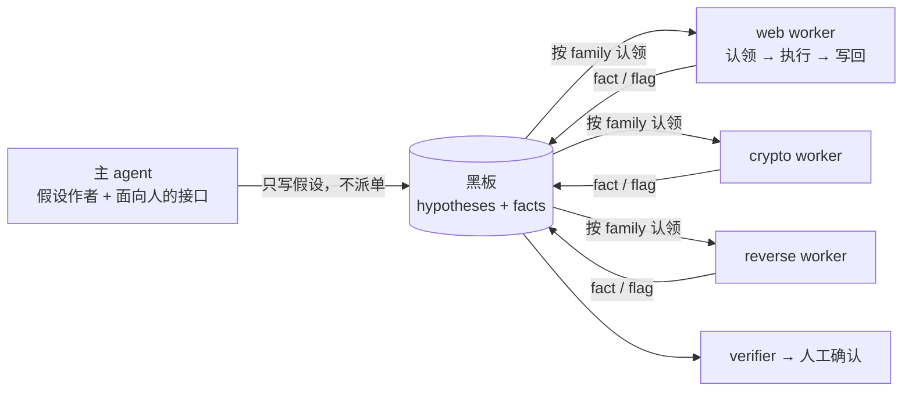

# CTF 专用蜂群：黑板市场式受控蜂群

日期：2026-11-01 · 状态：B 阶段已接线（`limits.swarm = "board"`，默认 off）· 基线：`orchestrator.py` 星型派工 + 黑板 + verifier/人工门禁

## 0. 一句话

把「谁决定下一步做什么」从主 agent 移到黑板上：**主 agent 只写假设，worker 按自己的方向认领假设并租约执行**，门禁链（verifier 复现 → 人工确认 → 提交另一次点击）原样保留。

不是把 agent 变多，是把串行决策变成可并行的自助市场。

## 1. 边界：明确不做什么

| 不做 | 原因 |
|---|---|
| 全去中心 | 会拆掉 `propose_flag → verifier → confirm_flag` 这条最有价值的链 |
| 从文本里猜假设家族 | `family` 用于分派方向，关键词匹配在这里等于随机分派 |
| 结论投票 | 多数派不等于正确。沿用 `supersedes` / `resolves` + verifier，不新增共识机制 |
| 新增 agent 角色 | 复用 `triage/web/.../verifier/writer`；蜂群改的是认领权，不是角色表 |
| 提高并发上限 | `max_sessions=12` 是内存硬约束（每子进程 150–250MB）。板子宽度（`swarm_max_workers`）只决定「一次挂多个方向时能开几个」，不突破这个池子 |

## 2. 拓扑



主 agent 被有意降级。它现在是 `$90 / $258 = 35%` 的成本和最长串行等待段，降级为「假设作者」后，它的回合只在有新材料可读时才需要发生。

## 3. 角色职责的变化

| 角色 | 现在 | 蜂群后 |
|---|---|---|
| 主 agent | 探索 + 派单 + 汇总 + 回退 | **只写假设**（带证伪判据与触发观测），并对人负责 |
| worker | 被动等派单 | **自助认领** → 租约执行 → 写回 → 续租或释放 |
| verifier | 独立复现 flag | 不变（仍享预算预留） |
| writer | 出报告 | 不变 |
| patrol | 判停滞 | 不变；可把「没人在做的假设」当巡检对象 |

## 4. 数据模型

新增一张表，**不动 `tasks` 与 `facts` 的语义**：

```sql
CREATE TABLE hypotheses (
  id          INTEGER PRIMARY KEY,
  run_id      INTEGER NOT NULL,
  family      TEXT NOT NULL,      -- 由提出者显式给出
  statement   TEXT NOT NULL,      -- 一句话假设
  criterion   TEXT NOT NULL,      -- 出现什么观测即证伪（硬约束）
  evidence    TEXT NOT NULL,      -- 触发它的观测（硬约束）
  origin      TEXT NOT NULL,      -- lead / task#N / patrol#N
  basis       TEXT,               -- observed/derived/inferred/external
  priority    INTEGER DEFAULT 0,
  status      TEXT DEFAULT 'open',-- open/claimed/supported/refuted/abandoned
  claimed_by  INTEGER,            -- task id
  lease_until REAL DEFAULT 0,     -- 租约到期（epoch 秒）
  supports    INTEGER DEFAULT 0,
  refutes     INTEGER DEFAULT 0,
  created_at  TEXT DEFAULT (datetime('now'))
);
```

三条轨道的分工，不要混：

- **`hypotheses`**：还没做的事（可认领的工作单元）
- **`tasks`**：正在做和做过的事（执行记录，现有）
- **`facts`**：做完之后知道的事（结论，现有）

假设的终态由事实驱动：`supported` 需要一条 `basis=observed` 的 fact 支撑；`refuted` 需要带范围与对照的否定（否则只是「没找着」，不是「不存在」）。

## 5. 核心协议

### 5.1 挂单（post）

硬校验，不过滤任何"看起来弱"的假设，只过滤**无法被证伪的**：

```
缺 criterion → 拒收（"也许有洞"不是工作）
缺 evidence  → 拒收（没有观测支撑的假设不许上板）
缺 family    → 拒收（方向无法分派）
```

同族同表述合并，保留 `supports` / `refutes` 历史——**一条已经失败两次的方向，换种说法重新挂单不会洗白**。

### 5.2 认领（claim）

```
候选：status=open 且未终态
打分：priority + 5（family 匹配 worker 方向）− 4×refutes + min(supports,2)
选中：status=claimed, claimed_by=task_id, lease_until=now+300s
```

落地用一条 SQL，**原子性靠它，不靠锁**：

```sql
UPDATE hypotheses SET status='claimed', claimed_by=?, lease_until=?
WHERE id=(SELECT id FROM hypotheses WHERE run_id=? AND status='open'
          ORDER BY priority DESC, id ASC LIMIT 1)
  AND status='open'
```

`max_sessions=12` 和 `workers_per_run=4` 不变——蜂群不提高这两个资源上限。板子自己的扇出宽度 `swarm_max_workers` 由 2 提到 3（§8.1）：它不是新上限，只是让已有池子在「同时挂着多个方向」时真的用满，`min(swarm_max_workers, workers_per_run)` 仍然是有效并行度。

### 5.3 租约与回收

- 认领带 300 秒租约，**每写一条 fact 自动续租**（写 fact 即心跳，不用额外工具）。
- 过期 → 回 `open`，`claimed_by` 清空。300 秒短于现有 `stall_timeout_s=900`：卡死的会话先丢租约，再被时钟判死。
- 租约不是所有权。worker 崩溃不能永久锁死一个方向。

### 5.4 结算

预算改为**预约制**，因为去中心之后没有人替全群体踩刹车：

- 认领时按 `role_budget_usd` 预约，`_reserved` 已有记账基础。
- 结束时 `settle(actual)`，释放未花掉的额度。
- **保留 15% 给收尾角色**：verifier/writer 永远能起。这一点和 `CLOSING_ROLES` 的现有语义一致——否则会出现"板上一堆结论、没人能复现 flag"。

### 5.5 收敛

```
有 claimed       → working
无 claimed 有 open → postable（等人认领）
都没有 + 有候选 flag → needs_input
都没有 + 无 flag    → idle
```

**`idle` 是结果，不是"再造一批假设"的信号。** 一个会自己填满队列的蜂群永远结束不了。`idle` 时只允许主 agent 再造一轮假设，每题限 2 轮。

## 6. 与现有代码的接缝

| 改动 | 位置 | 说明 |
|---|---|---|
| 挂单工具 | `worker_tools.py:23` 加 `post_hypothesis`；`tools.py:26` 加主 agent 侧同名 |  schema 强制 `family/criterion/evidence` 必填 |
| 认领工具 | `worker_tools.py` 加 `claim_hypothesis` | 内部调 `swarm.claim` + 一条原子 UPDATE |
| 工单与假设绑定 | `dispatch`（`orchestrator.py:1873`）新增 `hypothesis_id` 可选参数 | 不传则保持现有星型行为，**向后兼容** |
| 租约心跳 | `record_fact`（`:3022`）里续租 | 不需要新工具 |
| 过期回收 | 现有看门狗节拍里调 `swarm.reclaim` | 复用预算/时钟循环，不起新线程 |
| 预算预约 | `_task_budget`（`:1607`）改走 `swarm.Budget` | 收尾角色例外保持 |
| 主 agent 降级 | `_main_spec`（`:1511`）把 `dispatch_task` 换成 `post_hypothesis` | 仅在 `swarm` 模式开启时；保留原模式 |
| 新事件 | `hypothesis.posted/claimed/expired/settled` + `board.idle` | 事件是唯一真相源，不能只 `logging` |

## 7. 故障模式与对策

| 故障 | 对策 | 落点 |
|---|---|---|
| 同族重复劳动 | `dedupe` 按 `(family, 规范化表述)` 合并，in-progress 的不给第二个人 | `swarm.dedupe` / `claim` |
| 无依据扇出 | 挂单强制带触发观测 | `swarm.post` |
| 租约僵死 | 300s 租约 + 写 fact 续租 + 过期回收 | `swarm.is_expired/reclaim` |
| 结论互相覆盖 | 沿用 `supersedes` 链；不引入投票 | 现有黑板 |
| 主 agent 被架空 | 降级为假设作者 + 面向人的接口，不是删除 | `_main_spec` |
| 成本失控 | 预约制 + 15% 收尾预留 + 单工单上限 | `swarm.Budget` |
| 永不停歇 | `idle` 是终态；每题最多 2 轮补充假设 | `swarm.convergence` |
| 卡死会话占着方向 | 租约短于 stall 时钟，先丢租约再判死 | 300s < 900s |

## 8. 必须新增的度量（没有就别上线）

| 指标 | 看什么 |
|---|---|
| 同族重叠派工次数（`families_with_two_claimants`） | 是否有同一 family 的两个会话同时在跑。按任务起止时间算重叠，**不数认领人**——撞上限后的合法重试会被按认领人计数误判成重复 |
| 假设存活时长分布 | 认领后多久被证明/证伪 |
| `refutes ≥ 2` 的假设占比 | 板上是不是堆着死路 |
| 未结算占比（`unsettled_share`） | 板子是不是 backlog 而不是市场 |
| `idle` 到达率（`idle_events`） | 能不能收敛 |
| 并发峰值（`peak_concurrency`） | 板子到底开了几个方向。按任务起止区间扫峰值，**排除 verifier/writer**——收尾角色走的是自己的路，不算一个方向 |
| 单位成功成本 | 与星型模式对照，唯一有意义的总指标 |
| 租约过期次数 | 多少会话是卡死的，不是慢的 |

`idle_events` 在没有板子事件的库里记 `null`（老 run 是「没测」），不是 0（「没收敛」）。

### 8.1 并发到底能开多大（2026-11-02 实测）

板子的有效并行度是 `min(swarm_max_workers, workers_per_run)`，再受「一个 family 一个活 worker」约束。所以提高 `swarm_max_workers` 只在一个 run 同时挂着**多个不同方向**时才有用。

历史库（49 个真实 run，2026-10-18 ~ 11-01）里，一个 run 出现过的不同方向数：0（1 次）、1（32 次）、2（7 次）、3（6 次）、4（1 次）、6（2 次）。按 `peak_concurrency` 的口径（排除 verifier/writer）重算单 run 并发峰值：1（25 次）、2（17 次）、3（6 次）、4（1 次），中位数 1、最大 4；全局（跨 run）峰值 8（2026-10-31 05:46）。结论：

- **瓶颈是方向多样性，不是内存。** 12 个会话 × 150–250MB ≈ 3GB，本机 34GB / 20 线程，池子从来没在这上面卡过。
- `swarm_max_workers` 由 2 提到 **3**：历史上单 run 并发峰值 ≥3 的有 7 次（3 个 6 次、4 个 1 次），第三个槽是真正用得上的最后一格，第 2 格则在 17 个 run 里被填满过。提到 4 不建议：run 池 `workers_per_run=4` 会被板子占满，主 agent 自己的 triage 就没槽了——板子宽度和主 agent 抢的是同一个池子。
- 想让 `peak_concurrency` 真的变高，第一件事是**让主 agent 一次挂多个方向**（提示词已写明），不是继续拧这个旋钮。
- **实测（`CTFAGENT_SWARM=board bench --only aes_pin`，`swarm_max_workers=3`）**：`peak_concurrency=1`。板上只挂了 1 条假设、1 个工单绑定，板子没有第二条可认领的方向可用——说明短板确实在**上板环节**，不在协调器。这次 `claim_latency_s=1.0`、`settle_latency_s=87`、`idle_events=1`（收敛），1/1 解出、$0.18 / 4 分 39 秒（`bench/results/hive-board-parallel.json`）。想验证「三槽真能同时跑」需要一道真有多条独立死路的题；现成的 6 道自造题都是单线索，测不出来。


## 9. 三阶段上线

- **A（观测）**：加表加事件，主 agent 仍派单，但每单必须绑定一个假设。先量「同族重复率」与「死路占比」。**不改任何行为。**
- **B（挂单）**：worker 可认领，主 agent 只挂单。`workers_per_run=4` 不变，与 A 同题对照跑 bench。
- **C（自治）**：预约制预算 + 租约自治，主 agent 退为假设作者。门禁链不变。

每阶段可独立回滚，`dispatch` 的 `hypothesis_id` 可选参数保证旧模式始终可用。

## 10. 已实现 / 未实现

**已实现：**

- `ctfagent/swarm.py` —— 挂单校验、规范化去重、认领打分、租约与回收、预约制预算、收敛判据；`tests/test_swarm.py` 纯函数，不 import `orchestrator`。
- `hypotheses` 表 + `lease_hypothesis` / `renew` / `clear_claim`（`db.py`）。
- `post_hypothesis` 工具（主 agent 与 worker 都可用）、`dispatch_task(hypothesis_id=...)` 绑定。
- 协调器 `Run._board_tick`：open 假设才有活、按 family 互斥（占用以 *活着的任务* 为准，不看累计计数）、板子自己的上限 `swarm_max_workers`（默认 3，理由见 §8.1）与 run 池 `workers_per_run` 分开记账、派工被拒立刻把假设放回板上，并给该 family 60 秒退避（拒绝原因——预算、端点、槽位——不会在 2 秒内自愈，否则每拍写一条同样的 `board.refused`）；可用额度为 0 时在派工前就拒绝，不放一个零额度的会话进去秒死（那会白占一个槽位并每拍重试同一条）。
- 结算 `Run._settle_hypothesis`：带观测依据的 `dead_end` 与 flag 候选才算结论；撞上限/崩溃/被停一律回板（连租约一起清）。
- 派工后叫醒空闲主 agent（`_wake_lead`，同一时刻只留一条待读通知，后续批次合并进去；只有队列真把这条交给主 agent 时才放闩，按文本前缀匹配会被一行引用了它的对话误清）。
- 前台预算：板子自己的账本 `swarm.Budget` 与 run 池的 `_committed` 并存，派工时取两者中更小的余量；只有板子开的会话走板子账本（主 agent 自己派的 verifier/triage 不受第二本账限制）。hold 在 `_worker_spec` 里按任务注册一次，在 `_run_task` 的 `finally` 里一律 `settle`（按任务实际花费记账、退还未花的额度），所以崩溃、未启动、收尾续命都不会漏退。软上限（85%）同时约束协调器：过线后板子不再开新的探索方向，假设留在板上而不是被撤回。
- 收敛事件：`board.idle` 只在「没有可认领假设、也没有在跑的工单」这一种状态发一次（同一段空板不重复），供前端和基准对照「有没有真的收敛」。
- 前端：工作区侧栏新增「板子」页签（有假设才出现），状态用板子自己的四个词（待认领/在做/已证实/已证伪）；SSE 订阅 `hypothesis.*` / `board.*`，这些事件触发重渲染。
- 事件：`hypothesis.posted/claimed/released/refuted/supported/abandoned`、`board.dispatched/refused/unbound/error/idle`。
- 基准度量 `bench.swarm_metrics`（§8）：假设按状态计数、未结算占比、`families_with_two_claimants` 改为「真正时间重叠的同族派工」——重试不算重复；`claim_latency_s`（上板→首次派人）与 `settle_latency_s`（派人→首次结论/证伪），只取每个 run 的首次事件；没到达那一阶段的 run 记 `null` 而不是 0；`idle_events` 数 `board.idle`，数据库里根本没有板子事件时记 `null`（老 run 是「没测」，不是「没收敛」）；`peak_concurrency` 按任务起止区间扫并发峰值并排除收尾角色，`cli bench` 摘要里渲染成「并发峰值 N 个 worker」。
- 测试：`tests/test_swarm_board.py`（协调器规则 + 结算 + 叫醒）、`tests/test_swarm_e2e.py`（无一次 `dispatch_task` 跑完门禁链、worker 撞上限后同一条假设被重新派工、off 模式星型不变）。

**未实现**：C 阶段的自治租约回收（当前回收在 tick 里做）。预约制预算已接线（见上），但"预约"仍按任务的角色上限做，不是按假设的价值做。

**巡检对「没人在做的假设」**（本轮补上，原为最后一个未实现的巡检目标）：板子每 2 秒认领一次，所以一条挂了 **10 分钟**仍然 `open` 的假设不是「在排队」，而是三种情况之一——预算花完了（`board.refused`）、该 family 已被主 agent 派出的活 worker 占着、或者这条方向本身不可做。`patrol.evaluate(unworked=...)` 把它排在「有工单但没有新结论」之下、「工单跑得太慢」之上：慢工单至少在干活，空转的假设没人在干。被巡检过的假设按 **假设 id** 记账（`PatrolState.covered_hypotheses`，与任务 id 分开——一个 set 会让假设 id 把无关的工单标成已巡检）。

巡检多了一个可执行的结论 `CLOSE <假设号>`，落成 `patrol.apply_close`：只关本 run 的、状态仍是 `open` 的假设，关成 `abandoned`（**不是 `refuted`**——没有人观测过任何东西，记成证伪会让主 agent 读成「试过且被推翻」）。已经不在 `open` 的一律拒绝（claimed 的有人在做；supported/refuted/abandoned 已有结论，第二个结论就是自相矛盾），拒绝原因写进 `patrol.verdict.refused`。这是巡检唯一能改板子的地方，且它与 `_settle_hypothesis` 是两条路：结算必须落在 worker 的观测上，巡检的判断不可以。

**B 阶段首跑（2026-11-02，`CTFAGENT_SWARM=board`）**：两题、两题全解，都是主 agent 只挂假设、板子派人。

| 题 | 结果 | 成本 / 用时 | 上板→认领 | 认领→结论 | 板子 |
|---|---|---|---|---|---|
| `lcg_step` | 1/1 | $0.12 / 2 分 46 秒 | 1.0s | 58.0s | 1 条假设，证实 1，未结算 0%，同族重叠 0 |
| `rsa_wiener` | 1/1 | $0.12 / 2 分 33 秒 | 1.0s | 93.0s | 1 条假设，证实 1，未结算 0%，同族重叠 0 |
| `aes_pin`（`swarm_max_workers=3`） | 1/1 | $0.18 / 4 分 39 秒 | 1.0s | 87.0s | 1 条假设，证实 1，`idle_events=1`，**`peak_concurrency=1`** |

`lcg_step` 那次主 agent 第一次回复「准备派 crypto worker」，实际派工来自板子（`board.dispatched` 一条、`hypothesis.posted/claimed/supported` 各一条），随后它读到了叫醒通知并转为等待；verifier 仍由主 agent 直接派。两题的 bind 工单都是 1，说明「一单对一假设」在真实模型下也成立。

两个单题样本只能证明接线通与可复现，**不能证明相对 A 阶段的成本收益**——要下那个结论至少跑同一批 6 道自造题，且必须同题对照。

**待拍板**：① `family` 词表是否固定为 `ROLE_SKILL` 的方向集合；② 收尾预留比例 15% 是否合适；③ `idle` 后允许补充几轮假设（当前 2）；④ 主 agent 降级是在新模式开关下还是直接替换。
